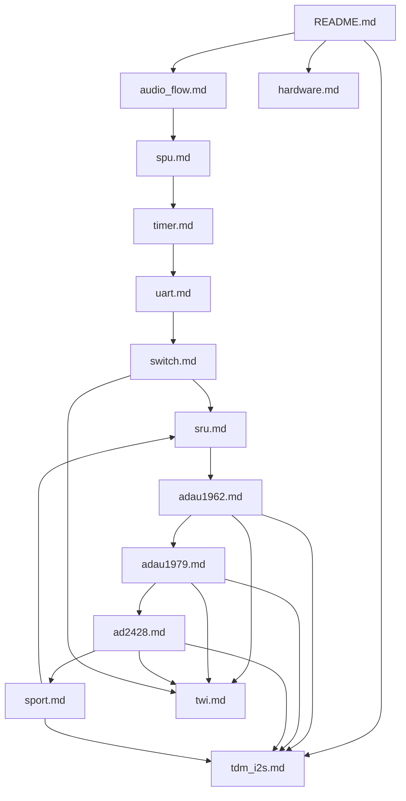

# ADSP-21593 Audio Framework / 工程与学习笔记总览

**[English](#english)** | **[中文](#中文)**

---

<a id="english"></a>

## English

Bare-metal firmware framework for the **Analog Devices ADSP-21593** (dual SHARC): board bring-up, peripheral drivers, and a real-time audio path for multi-channel ADC / DAC / A2B.

### Learning project & exchange

This repository is a **personal learning project**: start from the official eval board and ADI/CCES stack, then gradually peel away vendor abstractions to understand the hardware at a lower level.

It is **not** a product SDK and is **not** affiliated with any automotive OEM or Tier-1. The goal is study, experimentation, and open technical discussion. **Exchange and mutual learning are welcome** (issues, discussion).

### License

[MIT License](LICENSE).

### Target hardware

- **ADZS-21593-EZKIT** / **SOM-21593** — ADSP-21593 System-on-Module
- **SOMCRR-EZKIT** — SOM Carrier Board (EZKIT)

**A2B:** the official 21593 eval stack exposes **one** A2B master path (`AD24280`). There is **no second on-board A2B** (`AD24281` is an empty stub only).

### Roadmap

1. Stabilize CCES + ADI driver path on SOM-21593 / SOMCRR-EZKIT (audio I/O, A2B, UART).
2. Finish UART verification, then re-enable and harden A2B alongside the full audio flow.
3. Introduce a thin, self-owned HAL and reduce dependence on Analog Devices packaged driver libraries.
4. Move the build/startup flow off CCES toward a reproducible, toolchain-first workflow.

### Overview

| Core | Role |
|------|------|
| **SHARC1** (`sharc1/`) | Primary application core: audio I/O, device drivers, main loop |
| **SHARC2** (`sharc2/`) | Secondary core (minimal stub; ready for extension) |

### Version 0.0 — supported drivers

| Driver | Device / Block | Role |
|--------|----------------|------|
| **ADAU1979** | ADC | Multi-channel analog input |
| **ADAU1962** | DAC | Multi-channel analog output |
| **AD2428** | A2B | Automotive Audio Bus (primary path only on this board) |
| **SPORT** | SHARC SPORT | TDM framing and audio DMA |
| **TWI** | I²C | Codec / A2B register control |
| **UART** | UART | Debug / host I/O (lock-free ring buffer) |
| **SRU** | Signal Routing Unit | On-chip audio path routing |
| **SPU** | System Protection Unit | Peripheral access setup |
| **switch** | Board switch / mux | Board-level signal switching |
| **timer** | GP timer | Timing helpers |

### Project layout

```
framework/
├── sharc1/          # Core 1 (drivers + audio flow)
├── sharc2/          # Core 2
├── doc/             # Driver study notes (CN + EN) — tracked in git
├── .gitignore
├── LICENSE
└── README.md
```

### Build

Intended for **CrossCore Embedded Studio (CCES)** / Analog Devices SHARC toolchains:

1. Open the CCES workspace containing `sharc1` and `sharc2`.
2. Build both cores (SHARC1 typically boots and enables SHARC2).
3. Flash / debug with your usual ADSP-21593 connection.

### How to read the notes

Each topic is **one bilingual file** under [`doc/`](doc/): **`## English`**, then **`---`**, then **`## 中文`**.

**Convention:** every driver note uses three subsections in each language:

1. **代码实现 / Code implementation** — place in the audio chain, public API, call graph, init order, data flow.
2. **驱动配置 / Driver configuration** — registers, macros, clock parameters, pins, baud rates (values from code where possible).
3. **踩坑记录 / Pitfalls** — pitfalls, bring-up experience, engineering tips.

**Read [doc/tdm_i2s.md](doc/tdm_i2s.md) first** for shared TDM/I2S timing; other drivers link there instead of repeating theory.

### Documentation index

| Topic | File | Summary |
|-------|------|---------|
| **Shared audio timing** | [doc/tdm_i2s.md](doc/tdm_i2s.md) | TDM16 / 32-bit slot / master-slave / buffers |
| Hardware overview | [doc/hardware.md](doc/hardware.md) | Board, EZKIT, signal topology |
| End-to-end bring-up | [doc/audio_flow.md](doc/audio_flow.md) | `AudioFlowInit` order & demo DSP |
| SPORT DMA | [doc/sport.md](doc/sport.md) | Ping-pong DMA; **SP1B clock stagger trick** |
| SRU routing | [doc/sru.md](doc/sru.md) | DAI pins, BCLK/FS fan-out |
| SPU secure masters | [doc/spu.md](doc/spu.md) | SPORT/UART DMA IDs |
| TWI (I2C) | [doc/twi.md](doc/twi.md) | 100 kHz; **per-driver Open/Stop isolation** |
| Board switch (U6) | [doc/switch.md](doc/switch.md) | Codec enable / reset @ 0x22 |
| TMR0 1 ms tick | [doc/timer.md](doc/timer.md) | → `Uart0Poll` |
| UART log | [doc/uart.md](doc/uart.md) | 921600; **RX/TX polling model** |
| ADAU1962 DAC | [doc/adau1962.md](doc/adau1962.md) | I2C 0x04, clock **master** |
| ADAU1979 ADC | [doc/adau1979.md](doc/adau1979.md) | I2C 0x11, SAI **slave** |
| AD2428 A2B | [doc/ad2428.md](doc/ad2428.md) | SigmaStudio export / **USBi needs clocks & free TWI** |
| Architecture, protocols, A2B method | [doc/engineering_notes.md](doc/engineering_notes.md) | Cores, buses, SigmaStudio replay, USBi order |
| Bug review | [doc/bug_report.md](doc/bug_report.md) | Verified defects and what was changed |

### Dependency sketch



### Board reality check

On the **official ADSP-21593 eval path** (ADZS-21593-EZKIT / SOM-21593 + SOMCRR-EZKIT):

- **One** on-board A2B master: **AD24280** (I2C `0x68` / `0x69`), config table **829** entries.
- **AD24281** is an **empty stub** — no second A2B transceiver; `Ad24281Init()` is commented in `AudioFlowInit()`.
- **SPORT2** (A2B1) remains in code for legacy/topology reuse but has **no second A2B** on this hardware.

### Key constants (single source)

Defined in `sport.h`:

- `FRAME_LEN = 48` — samples per channel per DMA block (~1 ms @ 48 kHz).
- `TDM_NORM = 16` — DAC/ADC TDM slots.
- `TDM_A2B = 32` — A2B TDM slots (2 × 16).

---

<a id="中文"></a>

## 中文

面向 **Analog Devices ADSP-21593**（双核 SHARC）的裸机音频固件框架：板级启动、外设驱动，以及可用于多通道 ADC / DAC / A2B 的实时音频处理路径。

### 学习工程与交流

本仓库定位为**个人学习工程**：从官方评估板与 ADI/CCES 软件栈起步，逐步剥离厂商封装，弄清底层硬件与音频链路。

**不是**量产 SDK，也**不代表**任何车厂或 Tier-1。目的是学习、实验与开放的技术讨论。欢迎提 issue 或联系——**希望有互相学习的机会**。

### 许可证

[MIT License](LICENSE)。

### 目标硬件

- **ADZS-21593-EZKIT** / **SOM-21593**
- **SOMCRR-EZKIT** 载板

**A2B 说明：** 官方 21593 评估套件只有 **一路** A2B Master（`AD24280`）。板上**没有第二路 A2B**（`AD24281` 仅为空桩）。

### 路线图

1. 在 SOM-21593 / SOMCRR-EZKIT 上稳定 CCES + ADI 驱动路径（音频 I/O、A2B、UART）。
2. 完成 UART 验证后，重新启用并加固 A2B 与完整音频流。
3. 引入自研薄 HAL，降低对 ADI 打包驱动库的依赖。
4. 逐步脱离纯 CCES 工程，走向可复现的工具链优先构建流程。

### 概览与驱动表

| 核 | 角色 |
|----|------|
| **SHARC1** (`sharc1/`) | 主应用核：音频 I/O、驱动、主循环 |
| **SHARC2** (`sharc2/`) | 副核（当前为最小桩） |

版本 0.0 已支持驱动：**ADAU1979**（ADC）、**ADAU1962**（DAC）、**AD2428**（A2B）、**SPORT**、**TWI**、**UART**、**SRU**、**SPU**、**switch**、**timer** — 详见上表 English 节或各 [`doc/*.md`](doc/)。

### 工程结构

```
framework/
├── sharc1/
├── sharc2/
├── doc/             # 驱动学习笔记（中英）— 纳入版本管理
├── LICENSE
└── README.md
```

### 构建

面向 **CrossCore Embedded Studio (CCES)** / ADI SHARC 工具链：打开含 `sharc1`、`sharc2` 的工作区 → 编译双核 → 烧录 / 调试。

### 阅读方式

每个主题在 [`doc/`](doc/) 下**一个双语文件**：先 **`## English`**，再 **`---`**，再 **`## 中文`**。

**约定：** 每个驱动笔记在每种语言下分三节：**1 代码实现** · **2 驱动配置** · **3 踩坑记录**。

**请先读 [doc/tdm_i2s.md](doc/tdm_i2s.md)**；各驱动通过链接引用共享时序说明。

### 笔记索引

与 English 节「Documentation index」相同，并增加 [engineering_notes](doc/engineering_notes.md)（架构 / 协议 / A2B 配置方法）和 [bug_report](doc/bug_report.md)。

### 评估板说明

官方板仅 **AD24280** 一路 A2B；**AD24281 空桩**；`Ad24281Init()` 在 `AudioFlowInit()` 中已注释。

### 关键常量

见 `sport.h`：`FRAME_LEN = 48`，`TDM_NORM = 16`，`TDM_A2B = 32`。

---

*与 `sharc1/src/driver/` 代码对齐。*
