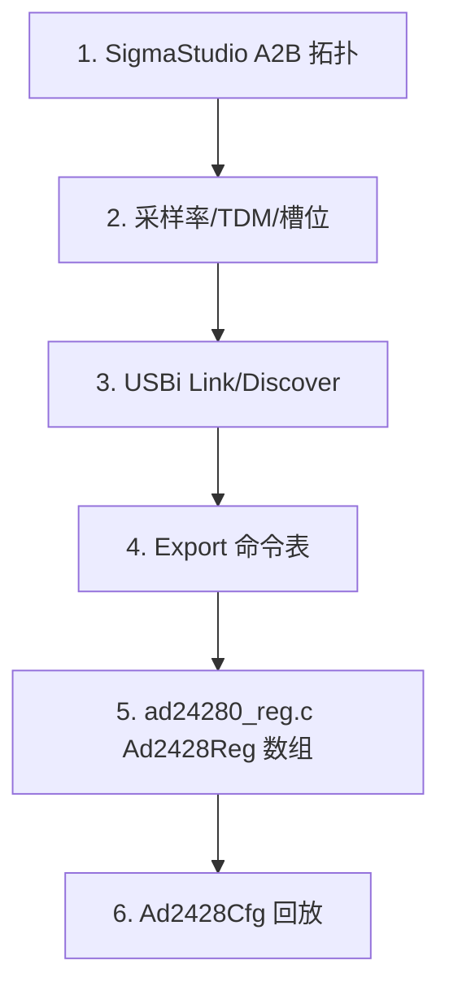
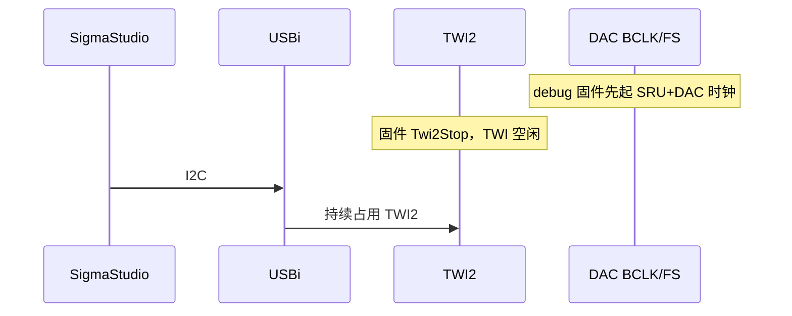

# AD2428 / A2B — SigmaStudio Export, USBi, Runtime Script

## English

**Summary:** Runtime replays SigmaStudio **Ad2428Reg** table over TWI. Official eval: **AD24280 only** (829 entries); **AD24281 empty stub**.

### 1. Code implementation

**Role:** `Ad24280Init()` after codecs, before `SpInit`; SP1A/B for 32-slot TDM. `Ad24281Init()` commented in audio flow.

**API:** `Ad24280Init`, `Ad2428Cfg`, `Ad24281Init` (stub).

Export flow: topology → USBi verify → embed `ad24280_cfg` → `Ad2428Cfg` executes WRITE/READ/DELAY with discovery polls on `0x13` / INTTYPE 24 & 255.

**AD24281:** `ad24281_cfg = { {0} }` only — no second transceiver on board.

### 2. Driver configuration

I2C **0x68** / **0x69**; **829** script entries; serial format matches [tdm_i2s.md](tdm_i2s.md).

USBi sequence: firmware clocks up + **TWI free** → plug USBi → unplug before firmware Open TWI again.

### 3. Pitfalls

USBi holds TWI2; clocks must run first. Clear **`BECNT` with 0**; **INTSRC+INTTYPE read clears**. Poor A2B daughtercards vs official; **domestic boards without U6 switch** break TWI bring-up ([switch.md](switch.md)). Cable quality matters.

**Sources:** `ad2428.c`, `ad24280_reg.c`, `ad24281_reg.c`

---

## 中文

**摘要：** TWI 回放 SigmaStudio 导出的 **Ad2428Reg** 表。官方板**仅 AD24280**（`0x68`/`0x69`，829 条）；**AD24281 空桩**。时序见 [tdm_i2s.md](tdm_i2s.md)。

### 1. 代码实现

**音频链位置：** `Ad24280Init()` 在 codec 之后、`SpInit` 之前；串行数据经 **SP1A/B**（32 slot）。`Ad24281Init()` 在 `AudioFlowInit` 中**已注释**。

**公开 API：** `Ad24280Init()`, `Ad24281Init()`（桩）, `Ad2428Cfg()`, monitor 命令（`ad2428.c`）。

**SigmaStudio → 固件：**

**运行时 `Ad2428Cfg`：**

| op_code | 行为 |
|---------|------|
| WRITE | 短写或 `Twi2DevRegLngWr` |
| READ | 短读（脚本校验） |
| DELAY | 忙等；特定点轮询 INTTYPE |

- `INTTYPE==255`：`MSTR_RUNNING`  
- 写 **`0x13` DISCVRY** 后轮询 `INTTYPE==24`：`DSCDONE`  

**AD24281：** `ad24281_reg.c` 中 **`ad24281_cfg` 仅 `{0}` 占位**；`AD24281_CFG_LEN` 为 1；`Ad24281Init` 仅 log — **官方板无第二收发器**。

### 2. 驱动配置

**I2C：** Master **0x68** / **0x69**（导出表内 `dev` 字段）。

**表规模：** `ad24280_cfg` — **829** 条 `Ad2428Reg`（`ad24280_reg.c`）。

**串行接口（`ad2428_reg.h` 注释）：** 48 kHz, TDM16, 32-bit, early FS, falling-edge sampling — 与 codec/SPORT 一致。

**USBi / 联调顺序（配置面，非替代固件 init）：**

1. 编译时保持 `AD2428_USBI_OWNS_TWI` 为 0，先确认 DAC PLL 能锁（BCLK/FS）。  
2. 需要 USBi 时把 `AD2428_USBI_OWNS_TWI` 置 1 再编译。`Ad24280Init` 在时钟就绪后**直接返回，不调用 `Twi2Open`**。  
3. USBi **未插入**时上电，等固件跑过 SRU + ADAU1962。  
4. 插 USBi，SigmaStudio 发现/下载。固件此时不得再 Open TWI2。  
5. 拔掉 USBi，把宏改回 0，重新编译烧录，由 `Ad2428Cfg` 回放脚本。  
6. `Ad2428ClkReady(0)` 时 `Ad24280Init` 也不会占总线。Master 或 discovery 超时会中止脚本并 `Twi2Stop`。

### 3. 踩坑记录

**USBi：** 只桥接 I2C 到 **TWI2**，**不产生** BCLK/FS。插上后 **一直占 TWI2**，即使失败也不自动释放 — 与固件 **不能同时** 当主机（[twi.md](twi.md)）。

**常见故障：** Master 发现失败 → 时钟未起或 TWI 占用；network path → 槽位与拓扑不一致；开路/reverse → 线束。

**A2B 寄存器习惯：** 读 **`INTSRC` + `INTTYPE` 同读会清**；**`BECNT` 需写 0** 清除。

**硬件杂项：** **劣质 A2B 子卡** EMI/干扰远大于官方子卡；线束质量影响 discovery。

**与 switch 相关：** 部分**国产板无 soft switch（U6）** → codec/A2B TWI 配置一直失败 — 见 [switch.md](switch.md)。

**多数 amp/acc 脚本**也是单字节地址+数据（与 codec 类似，非 A2B 长地址）。

**源文件：** `ad2428.c`, `ad24280_reg.c`, `ad24281_reg.c`, `ad2428_reg.h`
