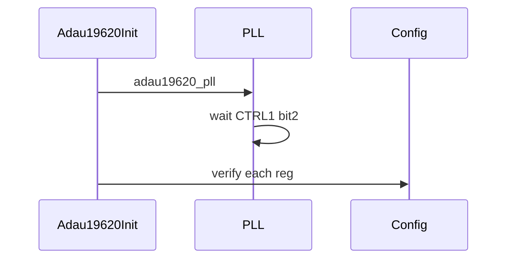
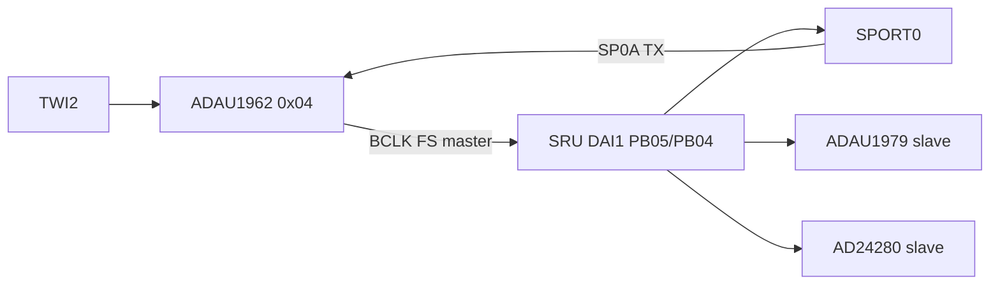
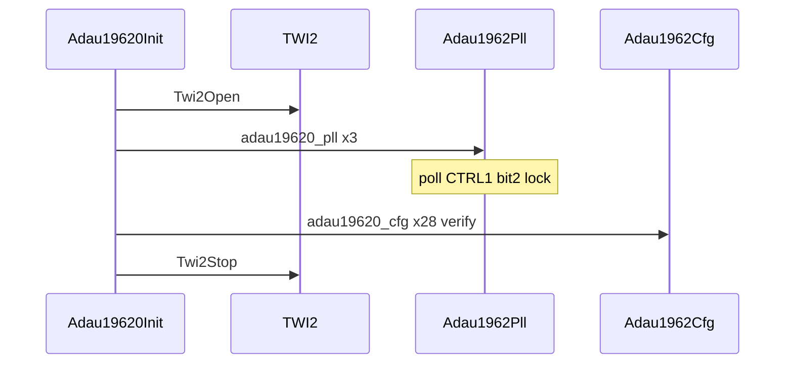

# ADAU1962 DAC 驱动 / ADAU1962 DAC Driver

## English

**Summary:** I2C **0x04**, **PLL then 28-entry config**; serial **clock master** at 48 kHz **TDM16**. Timing: [tdm_i2s.md](tdm_i2s.md).

### 1. Code implementation

**Role:** `Adau19620Init()` after SRU — **board BCLK/FS master**. SP0A feeds DAC data; DAC pins feed SRU clocks.

**API:** `Adau19620Init()`.

Open TWI → `Adau1962Pll` (3 writes) → poll lock → `Adau1962Cfg` (28 entries, readback) → close TWI.

### 2. Driver configuration

**Dev address:** **0x04**.

**PLL:** CTRL0 `0x01`, CTRL0 `0x05`, CTRL1 `0x22`; lock on **CTRL1 bit 2**.

**Key cfg values:** `DAC_CTRL1 = **0x43**`; `DAC_CTRL0` ends at **0x20** (TDM16 / 48 kHz / channels on); earlier `DAC_CTRL0 = 0x01` in table.

### 3. Pitfalls

PLL before config; switch before codec; rate changes touch entire chain; verify can false-fail on special regs.

**Sources:** `adau1962.c`, `adau19620_reg.c`, `adau1962_reg.h`

---

## 中文

**摘要：** I2C **0x04**（`ADAU19620_DEV`），先 **PLL** 再 **配置表**；串口侧为 **clock master**，48 kHz **TDM16**。时序见 [tdm_i2s.md](tdm_i2s.md)。

### 1. 代码实现

**音频链位置：** `Adau19620Init()` 在 `SruInit` 之后、`Adau19790Init` 之前 — **全板 BCLK/FS 的时钟源**。

**公开 API：** `Adau19620Init()`（`adau1962.h`）。

**Init 顺序：**

**数据流：** SP0A TX TDM16 → DAI1 PB01 → DAC；BCLK/FS 从 DAC 引脚经 SRU 扇出。

**TWI：** 设备内短读写 `Twi2DevAddrSet` + `Twi2RegShtWr/Rd`；Open/Stop 见 [twi.md](twi.md)。

### 2. 驱动配置

**I2C 地址：** **0x04**（7-bit，代码中 `ADAU19620_DEV`）。

**PLL 序列（`adau19620_pll`，长度 3）：**

| 寄存器 | 值 |
|--------|-----|
| `ADAU1962_PLL_CTL_CTRL0` (0x00) | 0x01 |
| `ADAU1962_PLL_CTL_CTRL0` | 0x05 |
| `ADAU1962_PLL_CTL_CTRL1` (0x01) | 0x22 |

**PLL 锁定：** 读 `ADAU1962_PLL_CTL_CTRL1`，**bit 2** — `while (!((val & 0x4) >> 2))`；超时 `TIME_BND` → `adau1962 pll fail`。

**配置表关键项（`adau19620_cfg`，28 条，写后读回校验）：**

| 寄存器 | 值 | 注释（代码） |
|--------|-----|--------------|
| `ADAU1962_DAC_CTRL1` (0x07) | **0x43** | MSBF, falling edge BCLK, **master**, 32-bit |
| `ADAU1962_DAC_CTRL2` (0x08) | 0x00 | 256× OSR |
| `ADAU1962_DAC_CTRL0` (0x06) | 先 0x01，末条 **0x20** | 末条：TDM16, 48 kHz, all channels on |

**头文件语义（`adau1962_reg.h`）：** Master, 48 kHz, **TDM16**, FS rising pulse, **early sync**, **MSBF**, **falling-edge sampling** — 与 SPORT MC 配置一致。

### 3. 踩坑记录

1. **必须先 PLL 后 cfg**，且 **Switch 先于 codec**（[audio_flow.md](audio_flow.md)）。  
2. 只改 DAC 采样率需同步 1979、A2B 导出、SPORT — 学习板默认全 48 kHz。  
3. 读回 verify 可能对 clear-on-read 寄存器误报 — 查数据手册。  
4. PLL 未锁或 TDM 与 `sport.c` 不一致 → 全体无声或 slot 乱。

**源文件：** `adau1962.c`, `adau1962_reg.h`, `adau19620_reg.c`
