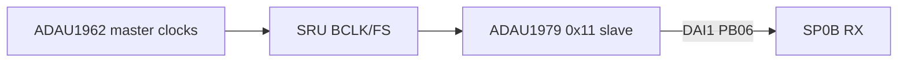
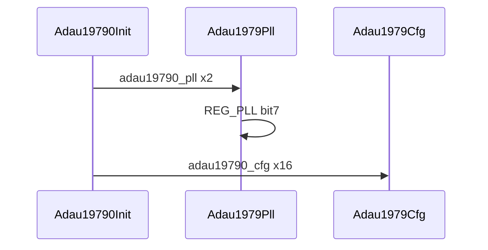

# ADAU1979 ADC 驱动 / ADAU1979 ADC Driver

## English

**Summary:** I2C **0x11**, PLL lock on **bit 7**, **SAI slave TDM16** on shared BCLK/FS. Timing: [tdm_i2s.md](tdm_i2s.md).

### 1. Code implementation

**Role:** Init after DAC; **SAI slave**; SP0B captures TDM16 into `adc_in()`.

**API:** `Adau19790Init()`.

Open TWI → PLL (2 regs) → poll **PLL bit 7** → cfg (16 regs, verify) → stop TWI.

### 2. Driver configuration

**Dev address:** **0x11**.

**PLL:** `REG_POWER = **0x01**`, `REG_PLL = **0x03**`; lock **bit 7** on `REG_PLL`.

**Key cfg:** `SAI_CTRL0 = **0x22**` (48 kHz TDM16; `FS[2:0]=010`). `0x23` selects the 64–96 kHz band. Power/SAI block 0x70 then 0x7F.

### 3. Pitfalls

Init after clocks exist; match DAC/A2B/SPORT format; check switch/mic bias; I2C 0x11 vs A2B 0x68.

**Sources:** `adau1979.c`, `adau19790_reg.c`, `adau1979_reg.h`

---

## 中文

**摘要：** I2C **0x11**（`ADAU19790_DEV`），PLL 锁定 **bit7**，SAI **TDM16 从模式**，跟 DAC 经 SRU 的 BCLK/FS。时序见 [tdm_i2s.md](tdm_i2s.md)。

### 1. 代码实现

**音频链位置：** `Adau19790Init()` 在 `Adau19620Init` 之后 — **从模式**，依赖外部时钟。

**公开 API：** `Adau19790Init()`。

**Init：** `Twi2Open` → `Adau1979Pll`（2 条）→ 轮询 PLL → `Adau1979Cfg`（16 条 verify）→ `Twi2Stop`。

**数据流：** SP0B RX → `Buf0/1Process` → `adc_in()`（16×`FRAME_LEN` float）；demo loopback 用前 4 路 — [audio_flow.md](audio_flow.md)。

### 2. 驱动配置

**I2C 地址：** **0x11**。

**PLL 序列（`adau19790_pll`，长度 2）：**

| 寄存器 | 值 |
|--------|-----|
| `ADAU1979_REG_POWER` (0x02) | **0x01** |
| `ADAU1979_REG_PLL` (0x01) | **0x03** |

**PLL 锁定：** `ADAU1979_REG_PLL` **bit 7** — `(val & 0x80) >> 7`；失败 → `adau1979 pll fail`。

**配置关键项（`adau19790_cfg`，16 条）：**

| 寄存器 | 值 | 说明 |
|--------|-----|------|
| `ADAU1979_REG_SAI_CTRL0` (0x05) | **0x22** | TDM16（`SAI=100`）+ 32–48 kHz（`FS=010`）。`0x23` 是 64–96 kHz |
| `ADAU1979_REG_SAI_CTRL1` (0x06) | 0x08 | |
| `ADAU1979_REG_BLOCK_POWER_SAI` | 0x70 → 0x7F | 先 mute 再 enable all |
| `ADAU1979_REG_CMAP12/34` | 0x01 / 0x23 | 通道映射 |

**SAI 注释（`adau1979_reg.h`）：** Slave, 48 kHz, **TDM16**, MSBF, **early sync**, FS rising pulse, BCLK tx rising。

### 3. 踩坑记录

1. **必须在 DAC + SRU 之后 init** — 无时钟则 PLL/SAI 无意义。  
2. 帧格式须与 DAC/A2B/SPORT 一致。  
3. Switch / mic bias 影响「无声 ADC」。  
4. 勿与 A2B **0x68** 混淆地址。

**源文件：** `adau1979.c`, `adau1979_reg.h`, `adau19790_reg.c`
