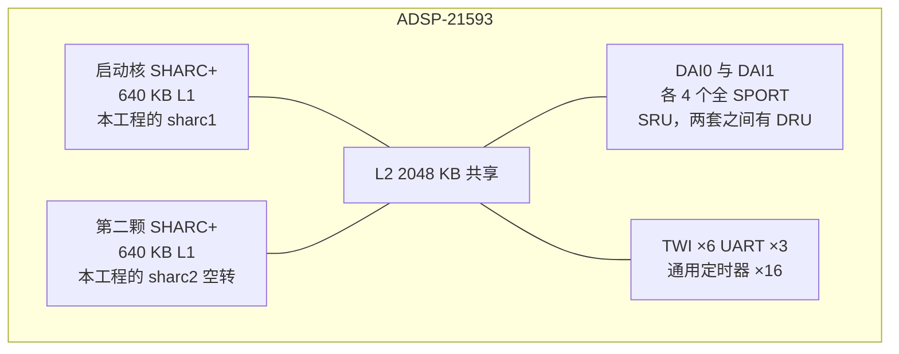
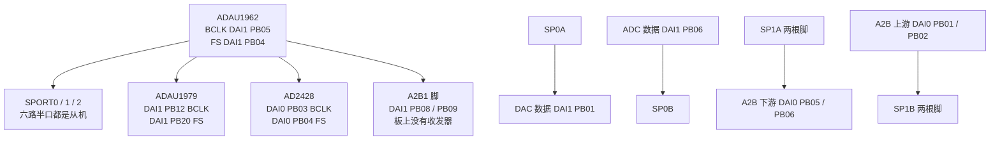
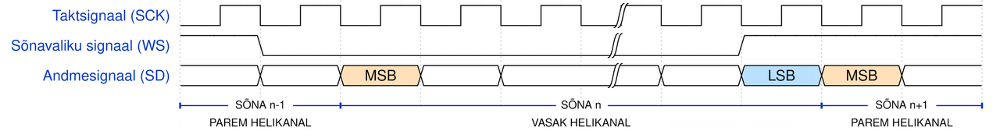
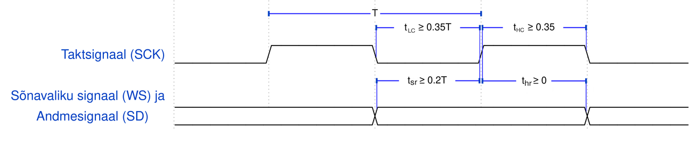
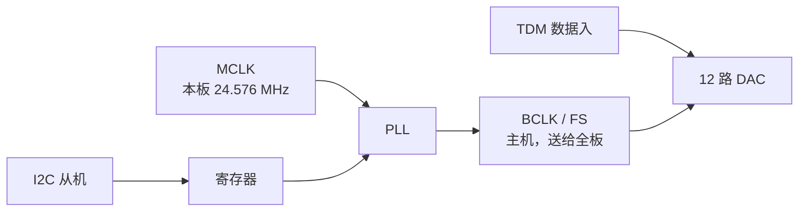
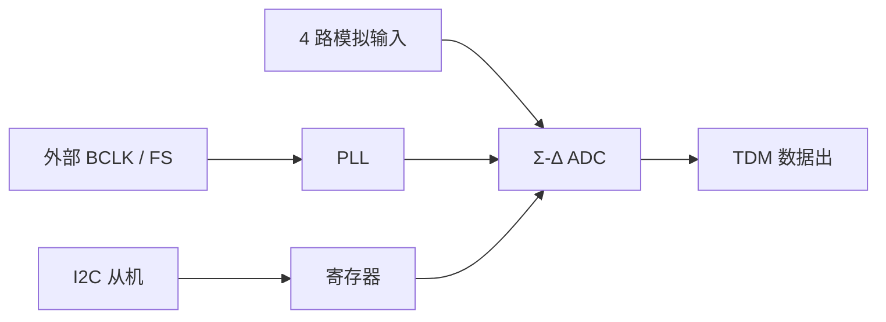
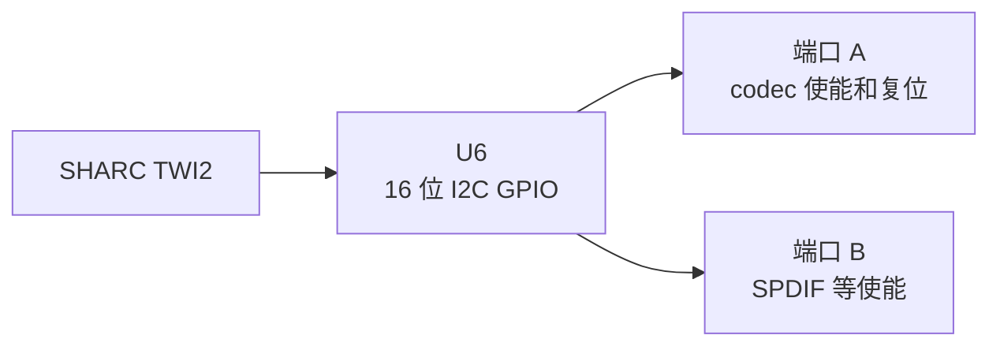
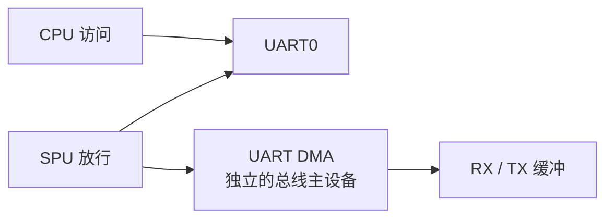
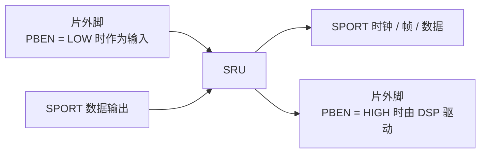

# ADSP-21593 音频框架

工程说明。已核实的缺陷在 [bugs.md](bugs.md)，不在这里重复。

数值以 `sharc1/src` 为准。SPORT 接口名以 CCES 3.0.3 的 `adi_sport_2156x.h` 为准：`adi_sport_ConfigClock` 的第 4 参是 `bFallingEdge`（`true` 为下降沿），不是上升沿选择。

---

## 1. 工程架构

### 1.1 板与两颗核

目标是 **ADSP-21593**（双 SHARC+）裸机音频。板卡是 **ADZS-21593-EZKIT / SOM-21593 + SOMCRR-EZKIT**。下面这张规格取自 ADSP-21593 产品页和数据手册 Rev. E。这颗片子没有 Arm。

| 项 | 规格 |
|----|------|
| 核 | 两颗 SHARC+。订货型号最高 800 MHz 或 1 GHz。32 / 40 / 64 bit 浮点，另有 32 bit 定点 |
| L1 | 每核 640 KB，带奇偶校验 |
| L2 | 2048 KB 共享，带 ECC |
| 片外存储 | 16 位 DDR3 / DDR3L 控制器 |
| 音频口 | 两套 DAI，共 8 个全 SPORT（每套 DAI 4 个）、28 个 DAI 缓冲。SRU 在一套 DAI 内接线，DRU 把两套 DAI 的源互相送过去 |
| 加速器 | 每核 1 个 FIR、4 个 IIR，跑在核时钟上 |
| 控制口 | TWI 6 个，UART 3 个，通用定时器 16 个，看门狗 3 个 |
| 其他 | 4 通道 12 bit 管理用 ADC，2 个 Link Port，1 个 Octal SPI，2 个 Quad SPI |
| 引脚 | 40 个 GPIO（Port A–C）加 28 个 DAI 脚 |
| 封装 | 17 mm × 17 mm、0.8 mm 间距、400 球 FCBGA |

数据手册把两颗核叫 SHARC0 和 SHARC1。CCES 工程 `sharc1` 是启动核，`sharc2` 是被它打开的另一颗。`adi_core_enable(ADI_CORE_SHARC1)` 里的枚举名指的是第二颗，不是把本核再打开一次。本工程只用启动核上的 SPORT0/1/2、TWI2、UART0 和 TMR0。EV-21593-SOM 的初始化代码把两颗核配到 1 GHz，把 SCLK0 配到 125 MHz。固件自己不调用 `adi_pwr_Init`，`timer.c` 按这 125 MHz 写 1 ms。



官方载板上只有 **一路 A2B 主节点**。代码里叫 AD24280，I2C `0x68`（主节点本地口）和 `0x69`（主节点转发到总线侧从节点的口）。AD24281（`0x6C` / `0x6D`）是空桩：`ad24281_cfg` 只有一条全 0，`AudioFlowInit` 里 `Ad24281Init()` 保持注释。SPORT2 和对应的 DAI1 线仍然接上了，板上没有第二颗收发器。

| 核 | 工程 | 角色 |
|----|------|------|
| CCES Core 1 | `sharc1/` | 音频、驱动、主循环 |
| CCES Core 2 | `sharc2/` | `adi_initComponents()` 之后空转，没有驱动 |

没有 SPI 驱动。`switch0_reg.c` 注释里的 MicroSD SPI、OCTAL_SPI_CS 是 GPIO 扩展器上的板级使能脚名字，固件不拨它们，也没有 SPI 控制器初始化。

工程里没有 `adi_pwr_Init`，也没有 CGU 配置。`timer.c` 按 **SCLK = 125 MHz** 写死 1 ms 和 UART 除数。codec 的 MCLK 是板级 **24.576 MHz `AUDIO_CLK`**（512 × 48 kHz）。本树不改内核时钟。

管脚复用（`pinmux_config.c`）只声明 UART0 和 TWI2。音频脚走 DAI，由 SRU 接线，不经过 `PORTA_MUX`。

| 功能 | 引脚 | `PORTA_MUX` | `PORTA_FER` |
|------|------|-------------|-------------|
| UART0 TX | PA6 | bit12 = 1 | bit6 |
| UART0 RX | PA7 | bit14 = 1 | bit7 |
| UART0 RTS | PA8 | bit16 = 1 | bit8 |
| UART0 CTS | PA9 | bit18 = 1 | bit9 |
| TWI2 SCL | PA14 | bit28 = 0 | bit14 |
| TWI2 SDA | PA15 | bit30 = 0 | bit15 |

RTS/CTS 只是复用到了引脚，UART 驱动没有打开硬件流控。

### 1.2 启动与初始化顺序

`sharc1/src/sharc1.c`：

1. `adi_initComponents()`（`sharc1/system/adi_initialize.c`）：`adi_sec_Init()`，然后 `adi_initpinmux()`，然后 `adi_mcapi_Init()`。
2. `adi_core_enable(ADI_CORE_SHARC1)`。这是 CCES 模板：正在跑的 Core 1 打开第二颗 SHARC。枚举名 `ADI_CORE_SHARC1` 指的是 Core 2，不是把本核再打开一次。
3. `AudioFlowInit()`。
4. `while (1) MonTmp();`。主循环只从 UART 取单字节监视命令。音频不在主循环里跑。

`AudioFlowInit`（`audio_flow.c`）的顺序有依赖，不能对调：

```text
Spu0Init → Uart0Init → Tmr0Init → Sw0Init → SruInit
        → Adau19620Init → Adau19790Init → Ad24280Init → SpInit
```

| 步骤 | 为什么在这个位置 |
|------|------------------|
| SPU | SPORT 和 UART 的 DMA 主设备要先在 SPU 里放行。 |
| UART 先于 TMR | TMR0 的 1 ms 回调就是 `Uart0Poll`。RX DMA 必须已经 `adi_uart_DMARead`。 |
| TMR | `adi_tmr_Config` 把 125000 个 SCLK 周期写进定时器，然后才 Enable。只填结构体不会生效。 |
| switch | I2C GPIO 扩展（`0x22`）打开 codec 电源并释放低有效复位，再空等至少 300 ms。 |
| SRU | 把 DAC 的 BCLK/FS 脚扇出到全部 SPORT、ADC 和 A2B。这一步只接线。DAC PLL 还没配，线上还没有稳定时钟。 |
| ADAU1962 | 全板唯一的 TDM 时钟主机。PLL 锁定后 `Adau1962ClkReady()` 变为 1，BCLK/FS 才算可用。 |
| ADAU1979 | SAI 从机，吃上面的 BCLK/FS。 |
| AD24280 | 时钟已锁定且 TWI2 空闲才回放发现脚本。USBi 必须已经拔掉。 |
| SPORT | 最后开 DMA。六路半 SPORT 都是时钟从机。 |

### 1.3 路由

SRU 不做协议，只在 DAI 和 SPORT 之间接线。`SruInit` 先把 `DAI0_IE` 和 `DAI1_IE` 写成 `0xFFFFF`，打开 DAI 输入使能。`PBEN` 为 HIGH 时该脚由 SRU 驱动出去；为 LOW 时该脚是输入，SPORT 或片外器件从这只脚取样。

时钟只有一个源头：ADAU1962。它把 BCLK 送到 DAI1 PB05，把 FS 送到 DAI1 PB04。这两只脚的 `PBEN` 是 LOW，DSP 不驱动它们。SRU 再把这两只脚的输入扇出。



**BCLK（源：DAI1 PB05）**

| 去向 | SRU |
|------|-----|
| SPORT0 A/B 时钟 | `SPT0_ACLK_I`、`SPT0_BCLK_I` |
| SPORT1 A/B 时钟 | `SPT1_ACLK_I`、`SPT1_BCLK_I` |
| SPORT2 A/B 时钟 | `SPT2_ACLK_I`、`SPT2_BCLK_I` |
| ADC | `PBEN12` HIGH，`DAI1_PB12_I` ← DAI1 PB05 |
| A2B0 | `DAI0_PBEN03` HIGH，`DAI0_PB03_I` ← DAI1 PB05 |
| A2B1（无器件） | `DAI1_PBEN08` HIGH，`DAI1_PB08_I` ← DAI1 PB05 |

**FS（源：DAI1 PB04）**

| 去向 | SRU |
|------|-----|
| SPORT0 A/B 帧同步 | `SPT0_AFS_I`、`SPT0_BFS_I` |
| SPORT1 A/B 帧同步 | `SPT1_AFS_I`、`SPT1_BFS_I` |
| SPORT2 A/B 帧同步 | `SPT2_AFS_I`、`SPT2_BFS_I` |
| ADC | `PBEN20` HIGH，`DAI1_PB20_I` ← DAI1 PB04 |
| A2B0 | `DAI0_PBEN04` HIGH，`DAI0_PB04_I` ← DAI1 PB04 |
| A2B1（无器件） | `DAI1_PBEN09` HIGH，`DAI1_PB09_I` ← DAI1 PB04 |

六路半 SPORT 的位时钟和帧同步都是外部输入。没有一路在片内产生 BCLK。采样率也没有单独的 SPORT 寄存器，它由 DAC 的 PLL 和帧格式定死：**48 kHz**。BCLK = 16 slot × 32 bit × 48 kHz = **24.576 MHz**，和板级 `AUDIO_CLK` 同频。

**数据**

| 半 SPORT | 方向 | 线上格式 | DAI | 说明 |
|----------|------|----------|-----|------|
| SP0A | TX → DAC | 1 根 TDM16 | `SPT0_AD0` → DAI1 PB01（`PBEN01` HIGH） | 只有主数据口 |
| SP0B | RX ← ADC | 1 根 TDM16 | DAI1 PB06 → `SPT0_BD0`（`PBEN06` LOW） | 只有主数据口 |
| SP1A | TX → A2B0 | 2 根 TDM16 | `SPT1_AD0` → DAI0 PB05，`SPT1_AD1` → DAI0 PB06 | 软件缓冲仍按 32 slot 排 |
| SP1B | RX ← A2B0 | 2 根 TDM16 | DAI0 PB01 → `SPT1_BD0`，DAI0 PB02 → `SPT1_BD1` | 同上 |
| SP2A | TX → A2B1 | 2 根 TDM16 | `SPT2_AD0` → DAI1 PB19，`SPT2_AD1` → DAI1 PB10 | 板上没有第二颗 AD2428 |
| SP2B | RX ← A2B1 | 2 根 TDM16 | DAI1 PB11 → `SPT2_BD0`，DAI1 PB07 → `SPT2_BD1` | 同上 |

A2B 方向按收发器的脚命名，不按 SHARC 的 TX/RX 命名。SHARC 的 SP1A 是发给 A2B 的下游；SP1B 是从 A2B 收回的上游。当前脚本里 A2B 的 `TX0EN`+`TX1EN` 打开两根 DTX，对应 SRU 上的 `SPT1_BD0` / `SPT1_BD1`。`RX0EN` 只开 DRX0 一根，`RX1EN` 关闭。SHARC 的 `SPT1_AD0` / `SPT1_AD1` 仍然两根都在发，A2B 只收接在 DRX0 上的那一根。

**控制面与时钟面是分开的。** TWI2（PA14/PA15，100 kHz）分时独占：switch `0x22` → DAC `0x04` → ADC `0x11` → A2B `0x68`/`0x69`。UART0（PA6/PA7）不进音频路由，只给调试和监视命令。TMR0 每 1 ms 调用 `Uart0Poll`，推动 UART RX 的写指针。

```text
ADAU1962 (I2C 0x04, BCLK/FS 主机)
    │  DAI1 PB05 = BCLK, DAI1 PB04 = FS
    │  SRU 扇出，SPORT / ADC / A2B 全是从机
    ├─ SP0A → DAI1 PB01 → DAC 数据
    ├─ DAI1 PB06 → SP0B ← ADC 数据
    ├─ SP1A → DAI0 PB05/PB06 → A2B 下游（两根脚，脚本只收 DRX0）
    ├─ DAI0 PB01/PB02 → SP1B ← A2B 上游（两根 TDM16）
    ├─ DAI1 PB12/PB20 → ADC 的 BCLK/FS
    └─ DAI0 PB03/PB04 → A2B0 的 BCLK/FS
       DAI1 PB08/PB09 → A2B1 的 BCLK/FS（无器件）
```

改一根音频脚要同时改三处：PCB、`signal_route.c` 里的 `SRU()`、以及对应半 SPORT 的 DMA 通道数。只改 SPORT 的 slot 数不会改线上的帧，帧由 DAC 主机决定。

### 1.4 运行时

SPORT 六路组成一个全局组。每次 DMA 半缓冲完成，`SpGroupCallback` 做 int32 ↔ float，然后 `adi_sec_Raise(INTR_TRU0_INT4)`。`AudioCallBack` 再调用 `AudioProcess`。主循环不参与这块。

DMA 缓冲是 **time-major** int32：`buf[i * 时隙数 + j]`。算法看到的 float 是 **channel-major**：`ptr[ch * FRAME_LEN + i]`。`FRAME_LEN = 48`，48 kHz 下一块约 1 ms。`AudioProcess` 用 `dac_out()` / `adc_in()` / `a2b0_in()` 各取一次基址，再按下标写。

| DAC 通道 | 内容 |
|----------|------|
| 0–3 | ADC 同通道环回 |
| 4–7 | `Harm1000()`，1 kHz 正弦，相位步进 `1000/48000` |
| 8–11 | A2B 输入槽 0/2/1/3，把两根 TDM16 上的相邻槽交错放出来听 |

主循环 `MonTmp` 读 UART 单字节：`0xAA` 读 A2B 中断和误码，`0xBB` 打印 UART underrun/overrun，`0xCC` 打印 SPORT 回调里用 `emuclk` 差除以 1000 的相对负载。其它字节丢掉。

---

## 2. 驱动

每一节三部分。**协议**只讲线和同步，不依赖本仓库。**ADSP 接口**讲这一颗片子上要调用的驱动函数。**本工程配置**才是当前树里的取值。

### 2.1 UART

#### 协议

UART 是异步全双工。没有时钟线。收发双方各自用本地波特率采样，靠起始位对齐。

| 线 | 方向 | 作用 |
|----|------|------|
| TX | 本机 → 对端 | 送数据 |
| RX | 对端 → 本机 | 收数据 |
| GND | 共地 | 没有共地，起始位无法判决 |
| RTS / CTS | 可选 | 硬件流控。不用时对端必须也不要等这两根线 |

一帧的常见形态是：1 位起始（空闲为高、起始为低）、8 位数据、低位先出、无校验、1 位停止。这就是 8-N-1。停止位把线拉回高电平，给下一帧的起始边沿留出下降沿。

波特率是双方约定的比特率，不是字节率。8-N-1 时每个字节占 10 个比特时间（1 起始 + 8 数据 + 1 停止）。921600 baud 大约是 92160 字节/秒，约 92 字节/毫秒。双方误差通常要留在约 ±2% 以内，否则一帧后半段的采样点会滑出比特中心。UART 控制器的分频只能取整数，实际波特率往往略偏离标称值。

因为没有帧同步线，驱动看不到“一帧结束”。字节边界只存在于起始位。把字节攒成命令，是上一层的事。

8-N-1 在线上就是起始位、8 位数据、停止位。下面这张是把可选位也画进去的帧：数据可以是 5 到 9 位，校验可有可无，停止位可以是 1 位、1.5 位或 2 位。本工程用的是其中的 8 位数据、无校验、1 位停止。空闲为高，起始为低，数据低位先出。


AmenophisIII 绘制，CC0。[Wikimedia Commons: UART Frame.svg](https://commons.wikimedia.org/wiki/File:UART_Frame.svg)

#### ADSP 接口

ADSP-21593 的 UART 由 `adi_uart` 打开。和本工程有关的调用：

| 函数 | 作用 |
|------|------|
| `adi_uart_Open(dev, dir, mem, mem_size, &handle)` | 打开控制器。`ADI_UART_DIR_BIDIRECTION` 为全双工 |
| `adi_uart_ConfigBaudRate(handle, prescale, divisor)` | 设定分频。波特率由 SCLK、预分频和除数一起决定 |
| `adi_uart_RegisterCallback` | TX 完成等事件 |
| `adi_uart_DMARead` / `adi_uart_DMAWrite` | RX/TX DMA |
| `adi_uart_Close` | 关闭 |

字长、校验、停止位如果不再编程，就停在驱动打开后的默认值。本系列默认是 8-N-1。

RX 若走循环 DMA，描述符的 `XCount` 是缓冲长度，`XModify` 是每字节步进。剩余次数在 DMA 通道的 `XCNT_CUR`。写指针是 `长度 - 剩余次数`。剩余次数读到 0 表示这一圈刚好写完，下一字节落在下标 0，不能把长度本身当写下标。

UART 的 DMA 通道号是这颗片子固定的。ADSP-21593 上 UART0 RX 是 **DMA21**，对应 `pREG_DMA21_XCNT_CUR`；UART0 TX 是 **DMA20**。

#### 本工程配置

`uart.c`。`Uart0Init` / `Uart0Poll` / `Uart0Rd` / `Uart0Wr` / `Uart0Close` / `Uart0Mon`。

| 项 | 值 |
|----|----|
| 设备 | `adi_uart_Open(0, ADI_UART_DIR_BIDIRECTION, …)` |
| 预分频 | `UART0_PRESCALE = 1`，按 SCLK 直接除，不再额外除 16 |
| 除数 | `UART0_DIV = 136`。SCLK 125 MHz 时 125e6/136 ≈ 919118 baud，比注释里的 921600 低约 0.27%，是最近的整数 |
| 帧格式 | 未再编程，默认 8-N-1 |
| 流控 | 未开。PA8/PA9 只是被管脚复用占住 |
| RX | 描述符指向自己，`XCount = 512`，`XModify = 1`，`ADI_PDMA_DESCRIPTOR_LIST` |
| TX | 停止模式 DMA，单次最长 512 字节 |

`Uart0Poll` 由 TMR0 每 1 ms 调用，只更新写指针和 overrun。`Uart0Rd` 在 `rd == wr` 时返回 1，并把 `underrun_cnt` 加 1。`MonTmp` 会一直读到空，空闲轮询也会计入 underrun。

`Uart0Wr` 拒绝空指针和 0 长度。超过 512 就分块，每块等 `ADI_UART_EVENT_TX_PROCESSED`。长度刚好是 512 的倍数时不再补一次 0 长度的 DMA。每次等待的超时是 `0x1000000` 次空转，独立重装。

`ShtLog` 把 `vsnprintf` 的结果交给 `Uart0Wr`。缓冲 128 字节，截断时只发 127 字节，不含结尾的 NUL。

监视字节没有帧头：`0xAA` / `0xBB` / `0xCC`，见 1.4 节。`tune.c` 里另有一套帧，**没有**接到 `MonTmp`，主循环不会解析它。格式按 `TuneRx` / `TuneTx` 的实现记在这里：

| 字段 | 宽度 | 含义 |
|------|------|------|
| 帧头 | 2 | 固定 `5A A5`，不进入 CRC |
| cmd | 1 | CRC 从这里开始，初值 `0xFFFF`，Modbus CRC16 |
| len | 0 或 1 | 仅 cmd `0x01` 有 1 字节长度。`0x02`–`0x04` 没有长度 |
| payload | len | 仅 `0x01`。`TuneTx` 拒绝 len > 255 |
| CRC | 2 | 低字节在前 |

CRC 正确后 `TuneProc` 目前把标志清掉，没有真正上传参数。`ack[]` 和 `nack[]` 没有被发送。

### 2.2 I2C / TWI

#### 协议

I2C 是同步、开漏、多主机总线。两根线：

| 线 | 作用 |
|----|------|
| SCL | 时钟，由当前主机产生 |
| SDA | 数据，开漏。空闲时被上拉到高 |

没有独立的片选。寻址靠帧里的 7 位地址加 1 位 R/W。地址字节低位为 0 表示写，为 1 表示读。10 位地址是另一套，本工程不用。

同步方式：数据在 SCL 为高时必须稳定，在 SCL 为低时改变。主机发 8 位，从机在第 9 个 SCL 拉低 SDA 作为 ACK。从机不应答就是 NAK，主机应结束这次传输。

帧的边界：

| 条件 | 含义 |
|------|------|
| SCL 高时 SDA 下降 | START |
| SCL 高时 SDA 上升 | STOP |
| START 之后没有 STOP，又来一次 START | 重复起始。同一台主机接着访问，常常是“先写寄存器地址，再读数据” |

标准模式 100 kHz，快速模式 400 kHz。占空比通常接近 50%。开漏加上拉决定上升时间，总线电容大时不能只把分频改快。

寄存器型从机最常见的两种事务。短写一次完成。短读在寄存器地址之后用重复起始改成读，中间没有 STOP。

一次传输在比特这一层是下图。S 和 P 发生在 SCL 为高的时候。中间每个数据位只允许在 SCL 为低的窗口里改变 SDA，图上是蓝色格子；绿色格子是这一位被采样时 SDA 必须保持稳定。


Marcin Floryan 绘制，公有领域。[Wikimedia Commons: I2C data transfer.svg](https://commons.wikimedia.org/wiki/File:I2C_data_transfer.svg)

7 位地址那一帧（地址、R/W、ACK、数据、ACK）的开放图是 [I2c 7bit telegram.png](https://commons.wikimedia.org/wiki/File:I2c_7bit_telegram.png)，VamosSándor，CC BY-SA 4.0。

多字节寄存器地址在线上是高字节先出。这和 SHARC 内存的小端不是一回事。线上每个字节内部仍是 MSB 先出，那是 I2C 的比特序，也和内存端序不是同一个概念。

地址和数据必须在同一次写里面。如果把它们拆成两次寻址写，从机会把数据的第一字节当成新的寄存器地址。

总线上同一时刻只能有一个主机。第二个主机（例如调试器）插在同一对 SCL/SDA 上时，固件无法从“自己有没有 Open”判断对方还在不在。

#### ADSP 接口

这颗片子的控制器叫 TWI，驱动是 `adi_twi`。

| 函数 | 作用 |
|------|------|
| `adi_twi_Open(dev, ADI_TWI_MASTER, mem, size, &handle)` | 打开为主机 |
| `adi_twi_SetPrescale` | 把 SCLK 分到约 10 MHz 的内部时基。125 MHz / 10 MHz = 12.5 |
| `adi_twi_SetBitRate` | 比特率，单位 kHz |
| `adi_twi_SetDutyCycle` | 占空比，百分比 |
| `adi_twi_SetHardwareAddress` | 7 位从机地址，不含 R/W |
| `adi_twi_Write(handle, buf, len, repeat_start)` | 写。最后一参为 true 时这条写以重复起始结束，不发 STOP |
| `adi_twi_Read` | 读。参数含义与 Write 相同 |
| `adi_twi_Close` | 关闭。NAK、仲裁失败或超时之后控制器可能停在没有 STOP 的状态，不 Close 再 Open，后面的从机都会跟着失败 |

#### 本工程配置

`twi.c` 只使用 **TWI2**。

| 参数 | 值 |
|------|----|
| 预分频 | 12 |
| 比特率 | 100 kHz |
| 占空比 | 50% |

本工程包出来的函数：

| 函数 | 线上事务 |
|------|----------|
| `Twi2Open` / `Twi2Stop` | 打开或关闭。忙时 Open 直接返回；已空闲时 Stop 直接返回 |
| `Twi2IsIdle` | 本核自己有没有打开 TWI2。看不出 USBi |
| `Twi2DevAddrSet` | 只设地址，给随后的 `Twi2RegShtWr` / `Twi2RegShtRd` 用 |
| `Twi2DevRegShtWr` | 一次写 `{reg, data}`，不重复起始 |
| `Twi2DevRegShtRd` | 先写 1 字节地址且重复起始，再读 1 字节 |
| `Twi2DevRegLngWr` | 地址按大端放 1、2 或 4 字节，后面紧跟最多 128 字节数据，一次 Write |

每个设备初始化都是自己的 Open、访问、Stop。从机地址：

| 从机 | 7 位地址 | 谁打开 |
|------|----------|--------|
| GPIO 开关 U6 | `0x22` | `Sw0Init` |
| ADAU1962 | `0x04` | `Adau19620Init` |
| ADAU1979 | `0x11` | `Adau19790Init` |
| AD2428 主节点 | `0x68` | `Ad24280Init` / `Ad24280Mon` |
| AD2428 总线侧 | `0x69` | 同一段会话，脚本里的 `dev` 字段 |

codec 寄存器都是 1 字节地址 + 1 字节数据，走短写。DAC 配置写完后会读回，不相等就 `ShtLog`。

### 2.3 TDM / I2S 与 SPORT

#### 协议

数字音频串行口用共享时钟把多路采样排进一帧。三根（或加多根数据）：

| 线 | 作用 |
|----|------|
| BCLK | 位时钟。一个边沿挪一位 |
| FS | 帧同步。标出一帧的起点，也叫 LRCLK 或 SYNC |
| DATA | 采样点。可以有多根，彼此并行，共用同一对 BCLK/FS |

同步方式是外同步：数据相对 BCLK 的边沿建立和保持，帧的起点相对 FS。谁产生 BCLK 和 FS，谁就是主机。从机只采样，不生成这两个时钟。一条链路上只能有一个时钟主机。

两种常用帧：

| | 经典 I2S | TDM |
|--|----------|-----|
| FS 形状 | 约 50% 占空比，一半帧左、一半帧右 | 一个 BCLK 宽的脉冲，后面跟着 N 个时隙 |
| 时隙数 | 2 | 8、16 或更多 |
| 数据相对 FS | 通常晚 1 个 BCLK（early / I2S 延迟） | 同样可以 early：FS 比时隙 0 的 MSB 早一个 BCLK |
| 位序 | 几乎总是 MSB 在前 | MSB 在前是默认 |

本链路用的是 **TDM 脉冲帧**，不是 50% LRCLK。48 kHz、每帧 16 个时隙、每时隙 32 个 BCLK 时，一帧有 512 个 BCLK，BCLK = 24.576 MHz。时隙里的有效数据可以少于 32 位（例如 24 位或 16 位），不满的位置在 MSB 对齐时补在低位。

I2S 的帧是下面这张。WS 低是左声道，高是右声道。WS 变化之后隔一个 SCK，才是新一个字的 MSB；一个字的末尾是 LSB。图上的爱沙尼亚语：Taktsignaal 是 SCK，Sõnavaliku signaal 是 WS，Andmesignaal 是 SD，VASAK HELIKANAL 是左声道，PAREM HELIKANAL 是右声道，SÕNA 是一个字。



Matthial 绘制，CC0。[Wikimedia Commons: I²S ajastusdiagramm.png](https://commons.wikimedia.org/wiki/File:I%C2%B2S_ajastusdiagramm.png)

同一作者按 Philips / NXP 的 I2S 规范重画了时序限度。T 是 SCK 周期。SCK 高、低各自至少 0.35T。接收端要求数据建立时间 tsr 至少 0.2T，保持时间 thr 至少 0。



Matthial 绘制，CC0。[Wikimedia Commons: I²S ajastusnõuded.png](https://commons.wikimedia.org/wiki/File:I%C2%B2S_ajastusn%C3%B5uded.png)

TDM 的脉冲帧没有一张同等、并且允许再发布的波形图。公开教程里把若干时隙、帧同步和串行数据画在一起的是 Cirrus Logic AN301《Time Division Multiplexed Audio Interface》的 Figure 2，版权在 Cirrus，笔记里不嵌这张图。[AN301 Rev 1](https://statics.cirrus.com/pubs/appNote/AN301REV1.pdf)

两根 DATA 共用同一对 BCLK/FS 时，每根仍是自己的 TDM16。软件可以把两根排进一块 32 槽缓冲，脚上并没有一根 32 槽的线。

采样沿必须两边一致。主机在一个沿改变数据，从机在另一个沿采样，中间留出建立时间。24.576 MHz 下半个 bit 约 20 ns。走线、线缆和中间器件的延迟会吃掉这个裕量，所以接收端有时要相对发送端错开一个沿。

#### ADSP 接口

SHARC 的串口是 SPORT。一个 SPORT 分成 A、B 两个半口，可以一个发、一个收，共用外面送进来的时钟。多通道模式（`ADI_SPORT_MC_MODE`）对应 TDM，不是立体声 I2S 的 50% 帧模式。

`adi_sport_ConfigClock(h, nClockRatio, bUseIntlClock, bFallingEdge, bGatedClk)`：

| 参数 | 含义 |
|------|------|
| `nClockRatio` | 写入时钟分频寄存器。驱动注释写内部时钟频率 `fsclk / (nClockRatio + 1)`。外部时钟时，脚上的 BCLK 不由这个分频产生 |
| `bUseIntlClock` | `true` 片内出时钟，`false` 用外部 BCLK |
| `bFallingEdge` | `true` 用 BCLK 下降沿采样数据和帧同步，`false` 用上升沿 |
| `bGatedClk` | 门控时钟。多通道模式下驱动忽略它 |

`adi_sport_ConfigData(h, eDataType, nWordLength, bLSBFirst, bEnablePack, bRightJustifiedMode)`：

| 参数 | 含义 |
|------|------|
| `eDataType` | `ADI_SPORT_DTYPE_SIGN_FILL` 为符号扩展 |
| `nWordLength` | 字长减 1。31 表示 32 bit |
| `bLSBFirst` | `false` 为 MSB 在前 |
| `bEnablePack` | 打包 |
| `bRightJustifiedMode` | 右对齐 |

`adi_sport_ConfigFrameSync(h, nFsDivisor, bFSRequired, bInternalFS, bDataFS, bActiveHighFS, bLateFS, bEdgeSensitiveFS)`：

| 参数 | 含义 |
|------|------|
| `nFsDivisor` | 写入帧分频。外部 FS 时，帧周期由外面的主机决定 |
| `bFSRequired` | 串行模式下是否需要帧同步。多通道模式下驱动忽略 |
| `bInternalFS` | `false` 为外部 FS |
| `bDataFS` | 发送方向上是否用与数据无关的帧同步。接收方向驱动会强制成 data-independent |
| `bActiveHighFS` | `true` 为高有效 |
| `bLateFS` | `true` 为 late，`false` 为 early（FS 比 MSB 早一个 BCLK） |
| `bEdgeSensitiveFS` | `true` 为边沿敏感，`false` 为电平敏感 |

`adi_sport_ConfigMC(h, nFrameDelay, nNumSlots, nWindowSize, bEnableDMAPack)`：

| 参数 | 含义 |
|------|------|
| `nFrameDelay` | FS 脉冲到第一个数据位之间的 BCLK 个数，0–15 |
| `nNumSlots` | 函数名是槽数，实现里原样写入 MCTL 的窗口大小字段。该字段在硬件上是槽数减 1 |
| `nWindowSize` | 窗口在 1024 通道范围里的起始偏移 |
| `bEnableDMAPack` | 多通道 DMA 打包 |

`adi_sport_SelectChannel(h, start, end)` 打开一段连续时隙。`adi_sport_CreateGlobalGroup` 把多个半口合成一组，一起启停。`adi_sport_DMATransfer` 的最后一个参数：只有主数据口时用 `ADI_SPORT_CHANNEL_PRIM`；主口和副口都接了数据时用 `ADI_SPORT_CHANNEL_PRIM_SEC`。DMA 的 `XModify = 4` 表示每个样本 4 字节。

打开顺序是 Open、配置、建组、挂描述符、各半口 Enable，最后 `adi_sport_GlobalEnable(true)`。时钟还没出现时就 GlobalEnable，DMA 会在没有帧的情况下空转或错位。

#### 本工程配置

`sport.c` 的 `SpInit`。六路都是 `ADI_SPORT_MC_MODE`，外部时钟，门控关闭。

公共项：`ConfigData(..., SIGN_FILL, 31, false, false, false)`；`ConfigClock` 的 `nClockRatio = 32`、`bUseIntlClock = false`、`bGatedClk = false`；`ConfigFrameSync(..., 31, false, false, false, true, false, true)`，即外部 FS、高有效、**early**（`bLateFS = false`）、边沿敏感。`ConfigMC` 的帧延时是 1，窗口偏移是 0，DMA 打包打开。

| 半 SPORT | 方向 | `bFallingEdge` | `ConfigMC` 第 3 参 | `SelectChannel` | DMA 通道 |
|----------|------|----------------|--------------------|-----------------|----------|
| SP0A | TX → DAC | `true`（下降沿） | 15（16 时隙） | 0–15 | 仅主口 |
| SP0B | RX ← ADC | `false`（上升沿） | 15 | 0–15 | 仅主口 |
| SP1A | TX → A2B0 | `false`（上升沿） | 31（32 时隙） | 0–31 | 主+副 |
| SP1B | RX ← A2B0 | `true`（下降沿） | 31 | 0–31 | 主+副 |
| SP2A | TX → A2B1 | `true` | 31 | 0–31 | 主+副，无硬件 |
| SP2B | RX ← A2B1 | `true` | 31 | 0–31 | 主+副，无硬件 |

SP1B 的沿和 SP1A 相反，用来换 A2B 回程的建立时间。组回调做定点与浮点转换，并触发 `INTR_TRU0_INT4`。算法侧的入口是 `adc_in`、`dac_out`、`a2b0_in`、`a2b0_out`、`a2b1_in`、`a2b1_out`，返回 channel-major 的 `float*`。

### 2.4 ADAU1962 DAC

规格取自 ADAU1962A 数据手册 Rev. A。板上这颗是 12 通道 DAC，本工程把它当成 TDM 主机。

| 项 | 规格 |
|----|------|
| 通道 | 12 路电压输出 DAC，可差分或单端 |
| 字长 / 采样率 | 24 bit，32 kHz 到 192 kHz |
| 动态范围 | 差分、A 计权 114 dB；单端 110 dB |
| THD+N | 差分 −97 dB；单端 −95 dB |
| 电源 | 数字 2.5 V，模拟和 I/O 3.3 V。全部供电下的静默功耗典型 249 mW（条件是 48 kHz、MCLK = 256×fs） |
| 时钟 | PLL 从 MCLK 产生，或直接使用主时钟。48 kHz 档插值 256 倍 |
| 串口 | I2S、左对齐、右对齐、TDM。可做主机或从机。TDM 时最多 12 个通道走一根数据线 |
| 控制 | I2C 或 SPI。每通道音量 255 级，步进 0.375 dB |
| 封装 | 80 脚 LQFP，汽车级 |



#### 协议

ADAU1962 在这条链上有两个角色：I2C 从机，以及 TDM 时钟主机。

控制面是 2.2 节的 I2C，7 位地址由 ADDR 脚决定。寄存器是 1 字节地址加 1 字节数据。上电顺序是：电源和复位已经释放，先写 PLL，等锁定，再写串口格式，最后让 DAC 通道退出掉电。PLL 没锁定就没有 MCLK 派生出来的 BCLK/FS，下游从机全部没有帧。

串口面是 2.3 节的 TDM。这颗片子作主机时，从 MCLK 分出 BCLK 和 FS。MCLK 与采样率的比就是倍频：24.576 MHz / 48 kHz = 512，对应 MCS 的 512×fs。帧格式要和所有从机写成同一组数：TDM16、32 bit 时隙、early FS、MSB 在前、约定好的采样沿。主机改一个字段，SPORT、ADC、A2B 必须一起改。

#### ADSP 接口

DSP 侧没有专用的 ADAU 驱动。配置就是 TWI 短写，然后读回。本工程的入口是 `Adau19620Init()`。`Adau1962ClkReady()` 在看到 PLL 锁定位置位后返回 1，供 A2B 初始化查询。

#### 本工程配置

地址 `0x04`。PLL 三步写在 `adau19620_pll`，中间各空转 `0xFFFF` 次，然后读 `PLL_CLK_CTRL1`（`0x01`）直到 **bit 2（PLL_LOCK，只读）** 为 1。超时约 `0xFFFF` 次读，失败只打日志，`adau1962_clk_ready` 保持 0，后面的 A2B 会因此退出。

| 顺序 | 寄存器 | 值 | 含义 |
|------|--------|----|------|
| PLL 1 | `PLL_CLK_CTRL0` `0x00` | `0x01` | 先按复位附近的值上电 |
| PLL 2 | `PLL_CLK_CTRL0` | `0x05` | 24.576 MHz / 48 kHz = 512 |
| PLL 3 | `PLL_CLK_CTRL1` `0x01` | `0x22` | 启动 PLL。bit 2 留给锁定状态，写入值本身的 bit 2 是 0 |
| 掉电 | `PDN_CTRL_1/2/3` | `0x00`, `0xFF`, `0x0F` | 通道先保持掉电 |
| 串口 | `DAC_CTRL0` `0x06` | 先 `0x01`，最后 `0x20` | `0x20`：SAI=`100` TDM16，FS=`00` 即 48 kHz |
| 串口 | `DAC_CTRL1` `0x07` | `0x43` | MSB 在前、BCLK 下降沿采样、主机、32 bit |
| 串口 | `DAC_CTRL2` `0x08` | `0x00` | 256× OSR |
| 静音 / 音量 | `0x09`–`0x17` | `0x00` | 不静音，主音量和 DAC1–DAC12 为 0 dB 码 |
| 驱动 | `PAD_STRGTH` `0x1C` | `0x00` | 默认驱动强度 |
| 电源 | `DAC_PWR1/2/3` | `0xAA` | 通道电源位 |
| 退出掉电 | `PDN_CTRL_2/3` | `0x00`, `0x00` | 在最终 `DAC_CTRL0 = 0x20` 之前 |

### 2.5 ADAU1979 ADC

规格取自 ADAU1979 数据手册 Rev. B。板上这颗是 4 通道 ADC，本工程把它当成 SAI 从机。

| 项 | 规格 |
|----|------|
| 通道 | 4 路 Σ-Δ ADC，两对立体声，输入可差分或单端 |
| 输入 | 差分满幅典型 4.5 V rms，交流耦合 |
| 动态范围 / THD+N | 典型 109 dB，THD+N 典型 −95 dB |
| 采样率 | 数据手册 Features 写 8 kHz 到 192 kHz，24 bit |
| 电源 | 单 3.3 V。片内产生数字 DVDD |
| 时钟 | 片内 PLL。主时钟可以来自外部时钟，也可以来自帧时钟 |
| 串口 | I2S、左对齐、右对齐、TDM。可做主机或从机 |
| 控制 | I2C 或 SPI |
| 封装 | 40 脚 LFCSP，汽车级 |



#### 协议

ADAU1979 在这条链上是 I2C 从机，也是 SAI 从机。它不产生 BCLK/FS，采样沿和帧格式必须跟着 DAC 主机。

控制面同样是 1 字节寄存器地址。PLL 锁定之前，串口从机会把数据脚上的位解释错。SAI 从机要写明：TDM 还是 I2S、时隙宽度、数据宽度、FS 是脉冲还是 50% 方波、MSB 先出还是 LSB 先出、以及自己是从机。

数据宽度和时隙宽度不是同一个数。时隙 32 个 BCLK、数据 24 位时，线上仍占满 32 bit，低位补 0。FS 字段选的是采样率档，不是一个自由的赫兹数；48 kHz 落在 32–48 kHz 这一档。

#### ADSP 接口

同样只用 TWI 短写。入口是 `Adau19790Init()`。

#### 本工程配置

地址 `0x11`。PLL：`M_POWER (0x00) = 0x01`，`PLL_CONTROL (0x01) = 0x03`。bit 7 是 PLL_LOCK（只读，轮询用）；低位 MCS=`011` 对应 32–48 kHz 的 512×fs。

`SAI_CTRL0 (0x05) = 0x22`：

| 位 | 字段 | 值 | 含义 |
|----|------|----|------|
| [7:6] | SDATA_FMT | `00` | 数据比 FS 边沿晚 1 个 BCLK |
| [5:3] | SAI | `100` | TDM16 |
| [2:0] | FS | `010` | 32–48 kHz。`011` 会变成 64–96 kHz |

`SAI_CTRL1 (0x06) = 0x08`（只有 bit 3 为 1）：

| 位 | 字段 | 值 | 含义 |
|----|------|----|------|
| 7 | SDATA_SEL | 0 | 数据从 SDATAOUT1 出 |
| [6:5] | SLOT_WIDTH | `00` | 每时隙 32 个 BCLK |
| 4 | DATA_WIDTH | 0 | 24 bit。该位为 1 才是 16 bit |
| 3 | LR_MODE | 1 | 帧同步是一个 BCLK 宽的脉冲 |
| 2 | SAI_MSB | 0 | MSB 在前 |
| 1 | BCLKRATE | 0 | 主机模式下每通道 32 个 BCLK。本片是从机，时钟由外部给出 |
| 0 | SAI_MS | 0 | BCLK/FS 从机 |

`BLOCK_POWER_SAI (0x04)` 先 `0x70` 再 `0x7F`：bit 6 BCLKEDGE=1（按上升沿发数据）、bit 5 LDO、bit 4 VREF 先开；`0x7F` 再打开四个 ADC 通道。`CMAP12 = 0x01`、`CMAP34 = 0x23` 相对复位值 `0x10` / `0x32` 对调了相邻通道，算法按这个映射听。后级增益四个通道都是 `0xA0`（0 dB）。过温驱动 `0xF0`。`MISC_CONTROL = 0x00`。

### 2.6 A2B

规格取自 AD2428 数据手册 Rev. F 开头的总线特性和收发器特性。本工程的拓扑是 1 个主节点加 12 个从节点，落在这张表的上限以内。

| 项 | 规格 |
|----|------|
| 角色 | 可配成 A2B 主节点或从节点。本板这颗是主节点 |
| 拓扑 | 一线菊花链。AD2426/2427/2428 系统最多 1 个主节点加 16 个从节点 |
| 线缆 | 100 Ω 非屏蔽双绞线。节点间距最长 15 m，全长最长 80 m |
| 超帧 | 与主机 SYNC 同频，典型 48 kHz。总线比特率是这个频率的 1024 倍，典型 49.152 MHz |
| 时隙 | 上游最多 32、下游最多 32。槽宽 8、12、16、20、24、28 或 32 bit。上游和下游的槽宽可以不同 |
| 面向主机 | 8 到 32 bit 的多通道 I2S/TDM。从节点还可到 96 kHz、192 kHz，主节点要用 2 倍或 4 倍的 TDM 通道去接 |
| 控制 | I2C。主节点转发到总线侧从节点。另有 GPIO 和中断 |
| 麦 | 最多 4 路高动态范围 PDM 麦，可与 I2S 同时收 |
| 其他 | 交叉线或直通线。SigmaStudio 配置。AEC-Q100 |


一个超帧里先下游、再上游，中间有一段总线不被驱动。发现按节点逐级做，数据手册写每个节点不到 35 ms。


#### 协议

A2B 是一条菊花链。物理层是一对差分线加上下游供电，不是 I2S 那三根线。同步由主节点的超帧完成：主节点先锁定自己的 PLL，再按响应周期逐级发现从节点。发现没完成时，下游节点的 I2C 和数据时隙都不存在。

面向 DSP 的那一侧又是一端口 TDM/I2S。收发器对 SHARC 是从机，BCLK/FS 必须从外面进来。主节点 PLL 锁定要看到这对时钟。USBi 一类的调试器只桥接 I2C，不产生 BCLK/FS。

本地控制仍是 I2C。主节点有两个 7 位地址：一个访问主节点自己，一个经主节点转发到当前总线侧从节点。发现过程写 `DISCVRY`，再等中断类型变成“发现完成”。全部节点到齐后写“结束发现”。改时隙结构后要再写一次“新结构”，让已发现的节点跟上。

和 TDM 直接对应的字段是：TDM 模式、时隙宽度、SYNC 是脉冲还是 50%、SYNC 相对 MSB 是 early 还是 late、收发各自在 BCLK 的哪一沿、开了几根数据脚、脚与脚之间是否交错。两根不交错的数据脚表示低半时隙在第一根、高半在第二根。只开一根接收脚时，另一根上的数据不会进总线。

中断状态寄存器有的是读清。误码计数要写 0 才清。监视和脚本回放如果各读一次，会把对方刚看到的中断清掉。

#### ADSP 接口

DSP 侧没有 A2B 专用外设。发现和寄存器都走 TWI。本工程把 SigmaStudio 导出的命令收成 `Ad2428Reg`，由 `Ad2428Cfg` 回放。

| 字段 | 含义 |
|------|------|
| `dev` | I2C 地址 |
| `op_code` | `WRITE 0` / `READ 1` / `DELAY 2` |
| `reg_width` | 寄存器地址字节数 |
| `reg` | 地址 |
| `val_width` / `val_len` / `val_ptr` | 载荷 |

入口是 `Ad24280Init()`、`Ad24280Mon()`。`Ad24281Init()` / `Ad24281Mon()` 在官方板上是空操作。

#### 本工程配置

`ad24280_cfg` 有 **829** 条：WRITE 765、READ 49、DELAY 15。每条 `reg_width`、`val_width`、`val_len` 都是 1。地址：`0x68` × 158，`0x69` × 656，`0x00` × 15（只出现在 DELAY）。拓扑注释：12 个从节点，每节点 2 个麦，48 kHz，下降沿采样，FS 上升沿脉冲，early FS，TDM16，32 bit 时隙，收发器相对 SHARC 是从机。

回放规则：单字节 WRITE 走 `Twi2DevRegShtWr`；READ 的返回值丢掉（读 `INTTYPE` 会清中断）；DELAY 忙等 `值 × 0x100000`。`val_width > 1` 立刻返回。本表不会触发。若将来导出 2 字节延时，按大端 `(b0<<8)|b1`。

两条和这张表绑在一起的轮询：

- 下标 `i == 1` 的 DELAY（第一条 DELAY，值 `0x19`）之后，等到 `INTTYPE` 为 **255** `MSTR_RUNNING`。
- 上一条寄存器是 **`0x13` DISCVRY** 时，这条 DELAY 之后等到 `INTTYPE` 为 **24** `DSCDONE`，`node_num` 加 1。

12 次发现的响应周期，逐级变小：`0x46, 0x42, 0x3E, 0x3A, 0x35, 0x31, 0x2D, 0x29, 0x25, 0x21, 0x1D, 0x19`。15 个延时字节：`0x19`，`0x01`，然后 12 个 `0x32`，最后 `0x01`。

主节点 `CONTROL (0x12)` 的三次写。bit7→bit0 为 `MSTR, Reserved, Reserved, XCVRBINV, SWBYP, SOFTRST, ENDDSC, NEWSTRCT`：

| 值 | 位 | 何时 |
|----|----|------|
| `0x84` | MSTR \| SOFTRST | 表的第一条。成为主节点并软复位 |
| `0x81` | MSTR \| NEWSTRCT | 软复位之后，以及时隙结构写完之后 |
| `0x82` | MSTR \| ENDDSC | 表的最后一条。结束发现 |

12 个从节点的 `CONTROL` 写 `0x00`。`XCVRBINV` 没有置位，脚本按交叉线而不是直通线。

第一次 `DISCVRY` 之前写入（手册要求 `I2SGCFG` 先于发现）：

**`I2SGCFG (0x41) = 0x44`**。bit7→bit0：`INV, EARLY, ALT, TDMSS, RXONDTX1, TDMMODE[2:0]`。

| 位 | 字段 | 值 | 含义 |
|----|------|----|------|
| 7 | INV | 0 | SYNC 上升沿对应通道 0 |
| 6 | EARLY | 1 | SYNC 比通道 0 的 MSB 早一个 BCLK |
| 5 | ALT | 0 | SYNC 是 1 个 BCLK 宽的脉冲 |
| 4 | TDMSS | 0 | 时隙 32 bit |
| 3 | RXONDTX1 | 0 | DTX1 不改作第三路接收 |
| [2:0] | TDMMODE | `100` | TDM16 |

**`I2SCFG (0x42) = 0x93`**。bit7→bit0：`RXBCLKINV, RX2PINTL, RX1EN, RX0EN, TXBCLKINV, TX2PINTL, TX1EN, TX0EN`。

| 位 | 字段 | 值 | 含义 |
|----|------|----|------|
| 7 | RXBCLKINV | 1 | DRX 在 BCLK 下降沿采样 |
| 6 | RX2PINTL | 0 | 两根接收脚不交错。这里只开了 DRX0 |
| 5 | RX1EN | 0 | DRX1 关闭 |
| 4 | RX0EN | 1 | 下游只从 DRX0 进总线 |
| 3 | TXBCLKINV | 0 | DTX 在 BCLK 上升沿变化 |
| 2 | TX2PINTL | 0 | 低 16 时隙在 DTX0，高 16 在 DTX1 |
| 1–0 | TX1EN, TX0EN | 1, 1 | 两根发送脚都开，对应软件 RX 缓冲的 32 时隙 |

**`SLOTFMT (0x10) = 0x42`**：上游 24 bit、不压缩，下游 16 bit。不满 32 bit 的时隙在 I2S 口上 MSB 对齐。**`DATCTL (0x11) = 0x03`**：上游和下游数据时隙都使能。**`SWCTL (0x09)`** 在发现流程里写 `0x01`（只开下游电源开关）和 `0x21`。`I2SRRATE = 0x01` 按导出值写入，不把它解释成另一套采样率。主时钟仍是 DAC 的 48 kHz。

`INTMSK0 = 0x70`，`INTMSK2 = 0x0D`，`BECCTL = 0xFF`，`RESPCYCS = 0x46`。`Ad2428Mon` 读 `INTSRC`、`INTTYPE`、`BECNT`，然后把 `BECNT` 写 0。误码类型 0–6 计入 `data_err_cnt`。

`Ad24280Init` 在回放前检查 `Adau1962ClkReady()` 和 `Twi2IsIdle()`，任一失败就打日志返回。

### 2.7 板级 GPIO 开关

U6 的寄存器地址和 MCP23017 这一类 16 位 I2C GPIO 扩展器一致：两个 8 位口，方向寄存器 `IODIRA` / `IODIRB`，输出锁存 `GPIOA` / `GPIOB`。7 位地址由地址脚决定，`0x22` 落在 `0x20`–`0x27` 这一档里。下面按这张寄存器图写，订货号以板上丝印为准。



#### 协议

载板上的 U6 是 I2C GPIO 扩展，寄存器排布与 MCP23017 一类器件一致。它不是第三条总线。DSP 通过 2.2 节的 I2C 写方向寄存器和输出锁存。

方向寄存器里 1 为输入、0 为输出。上电默认多为输入。若先把方向改成输出、锁存器还是复位值，脚上会冒出一个错误电平。所以先写输出锁存，再写方向。低有效的复位脚在电源已经打开之后再释放。codec 数据手册对复位释放后的等待有下限，短于这个时间就去配 PLL，锁定会超时。

#### ADSP 接口

没有单独的 GPIO 控制器驱动。`Sw0Init()` 打开 TWI2，按表短写，然后关闭。

#### 本工程配置

地址 `0x22`。

| 寄存器 | 地址 | 写入 |
|--------|------|------|
| IODIRA | `0x00` | `0x18`。bit4、bit3 为输入，其余为输出 |
| IODIRB | `0x01` | `0x00`。端口 B 全部输出 |
| GPIOA | `0x12` | 使能阶段 `0x05`，释放复位阶段 `0x25` |
| GPIOB | `0x13` | 两阶段都是 `0xFD` |

GPIOA bit7→bit0（低有效的脚用 `~` 标出）：

| bit | 脚 | 使能 `0x05` | 释放复位 `0x25` |
|-----|----|-------------|-----------------|
| 7 | `~ADAU1979_EN` | 0，打开 | 0，保持 |
| 6 | `~ADAU1962_EN` | 0，打开 | 0，保持 |
| 5 | `~ADAU_RESET` | 0，仍在复位 | 1，释放 |
| 4、3 | 未使用 | 0 | 0 |
| 2 | `~MicroSD_SPI` | 1，不启用 | 1 |
| 1 | `PUSHBUTTON_EN` | 0 | 0 |
| 0 | `EEPROM_EN` | 1 | 1 |

GPIOB `0xFD`：bit1 `~SPDIF_DIGITAL_EN` 为 0，其余保持不活动电平。

`Twi2Stop` 之后，`SwResetSettle` 用 `__builtin_emuclk` 空转 3×10^8 周期。ADAU1962A Rev. A 要求 PU/RST 之后 300 ms。CCLK 最高按 1 GHz 估，这个等待不会短于 300 ms。

### 2.8 通用定时器

#### 协议

这不是一条通讯总线。通用定时器用系统时钟计数，数到周期就产生事件。连续 PWM 模式还会在脚上打出一个脉冲，脉宽是周期的一部分。中断可以挂在周期点。回调里做的事必须短于周期，否则下一次中断会嵌套或丢掉。

1 ms 的周期计数 = SCLK 赫兹 / 1000。SCLK 不是标称值时，这个毫秒就不是毫秒。本树不初始化 CGU。EV-21593-SOM 的初始化代码把 SCLK0 配成 125 MHz，`timer.c` 按这个频率写死周期。


#### ADSP 接口

| 函数 | 作用 |
|------|------|
| `adi_tmr_Open(dev, mem, size, callback, arg, &handle)` | 打开并登记回调 |
| `adi_tmr_Config(handle, &cfg)` | 把 `ADI_TMR_CFG_PARAMS` 写进定时器。不调用它，Enable 用的是复位配置 |
| `adi_tmr_Enable` | 启动或停止 |
| `adi_tmr_Close` | 关闭 |

和本工程有关的配置字段：`Mode`、`IRQMode`、`ClkInSource`、`Period`、`Width`、`Delay`、`EnableGracefulStop`。

#### 本工程配置

`timer.c`。TMR0，连续 PWM，中断在周期点，时钟源系统时钟，周期 **125000**，脉宽是周期的 1/4，延时 0，允许优雅停止。回调只处理 `ADI_TMR_EVENT_DATA_INT`，里面只调用 `Uart0Poll`。`Tmr0Init` 的顺序是 Open、填结构体、`adi_tmr_Config`、Enable。

### 2.9 SPU

#### 协议

系统保护单元决定哪些主设备可以访问外设。它没有时钟线和数据线。DMA 引擎是独立的总线主设备。外设本身放行了、对应的 DMA 通道没放行，CPU 能打开设备，DMA 仍然写不进缓冲。

每个可保护的目标有一个编号。编号随片子和手册变，不能从 UART0 的设备号推导出它的 DMA 编号。



外设放行了、DMA 通道没放行时，CPU 能打开 UART，DMA 仍然写不进缓冲。

#### ADSP 接口

`adi_spu_Init(dev, mem, …, &handle)` 打开 SPU。`adi_spu_EnableMasterSecure(handle, id, true)` 放行一个目标。本工程在启动时一次做完，没有运行时关闭。

#### 本工程配置

`spu.c` 的 `Spu0Init`，9 个目标：

| ID | 外设 |
|----|------|
| 63, 64 | SPORT0 A/B |
| 65, 66 | SPORT1 A/B |
| 67, 68 | SPORT2 A/B |
| 29 | UART0 |
| 79 | UART0 RX DMA（DMA21） |
| 80 | UART0 TX DMA（DMA20） |

换 UART 或 SPORT 实例时要同步改这张表。

### 2.10 SRU

#### 协议

信号路由单元是片内交叉开关，不是串行协议。它把一只脚或一个外设信号连到另一个输入。方向由 pad 使能决定：使能输出时 DSP 驱动这只脚，关闭时这只脚是输入。时钟和数据可以扇出到多个目的地。扇出不改变帧格式，只改变谁看得到同一对 BCLK/FS。



同一套 DAI 里的连接走 SRU。源和目的分属 DAI0 和 DAI1 时，源文件里仍然写 `SRU()`，硬件走的是两套 DAI 之间的 DRU。本工程 DAC 的 BCLK 在 DAI1 PB05，A2B 的 BCLK 脚在 DAI0 PB03，对应 `SRU(DAI1_PB05_O, DAI0_PB03_I)`。

#### ADSP 接口

宏 `SRU(源, 目的)`。源是某个脚的 `_O` 或某个 SPORT 数据口的 `_O`。目的是另一个脚的 `_I` 或 SPORT 时钟/帧/数据的 `_I`。`PBEN` 用 `HIGH` 或 `LOW` 写入。DAI 组还要写输入使能寄存器，否则 pad 不把片外电平送进交叉开关。

#### 本工程配置

全部连接在 1.3 节。`SruInit` 的顺序是：打开 DAI0/DAI1 输入使能，扇出 BCLK，扇出 FS，再接六路数据。这一步发生在 DAC PLL 之前，所以调用返回时线上还没有稳定的 24.576 MHz。

---

## 3. 补充

这里是调试时会反复碰到的现象。对应的代码修改记录在 [bugs.md](bugs.md)。

**时钟先于 DMA。** SRU 接完不等于 BCLK 存在。DAC PLL 锁定之后，ADC 和 A2B 才有帧。SPORT 的 `GlobalEnable` 放在整条初始化的最后。

**只改 SPORT 不改主机。** 帧格式由 ADAU1962 决定，A2B 的 `I2SGCFG` / `I2SCFG` 必须是同一组数。三边的 early、时隙宽度或采样沿有一边不同，表现是槽位错开或噪声，不是 I2C 失败。

**软件 TDM32 是两根线。** `TDM_A2B = 32` 是主数据口加副数据口。脚上仍是两根 TDM16。A2B 脚本目前只让 DRX0 接收下游，SHARC 的第二根发送脚没有被收发器吃掉。

**SP1B 的沿是故意错开的。** `adi_sport_ConfigClock` 第 4 参 `bFallingEdge`：SP1A 为 `false`（上升沿），SP1B 为 `true`（下降沿）。A2B 往返加走线之后，24.576 MHz 下大约 20 ns 的半 bit 不够两边用同一个沿。换线长或拓扑之后要重新看眼图，不要为了“两边写一样”把它改回去。

**DMA 下标和算法下标不同。** 硬件缓冲按时间排，`AudioProcess` 按通道排，`ptr[ch * 48 + i]`。改混音前先写下标。

**浮点基址只取一次。** 每个通道一次函数调用返回 `float*`，编译器不敢把指针留在寄存器里，大约会到 30 MIPS。每个流取一次基址再按下标访问，大约 7 MIPS。`AudioProcess` 用的是后者。数据在 L1，差别来自编译器，不是 L2 cache。

**DMA 缓冲放在 L1，并且按驱动要求对齐。** CPU 和 DMA 同时看一块可缓存的内存时，会读到对方还没写到内存的旧值。UART 环和 SPORT 音频缓冲同一原则。跨中断共享的读写指针用 `volatile`，进函数先抄到局部变量。

**TWI 一次失败会传染。** NAK 或超时之后控制器可能没有 STOP。每个设备自己 Open 和 Stop，用开关开销换隔离。`Twi2DevRegLngWr` 的地址必须和大端数据拼成一次写。`reg_len` 不是 1、2、4 时函数直接返回，总线上没有任何波形。

**USBi 占着 TWI2，而且不出时钟。** 用 SigmaStudio 发现时：先让固件跑完 SPU、UART、TMR、switch、SRU、DAC、ADC，确认 BCLK/FS 已经从 DAC 出来，并且固件已经 `Twi2Stop`。然后插 USBi。拔掉之后才允许 `Ad24280Init`。`Twi2IsIdle` 只表示本核没有打开控制器。

**没有 U6 的板。** 一部分载板没有这颗 I2C GPIO。写 `0x22` 会 NAK，后面的 codec 和 A2B 都会失败。先确认板上有没有等价的上电和复位，再决定要不要跳过 `Sw0Init`。

**复位释放后要等。** ADAU1962A 要求 PU/RST 之后 300 ms。只空转几万次 `nop` 远不够，PLL 轮询会超时。

**定时器没配就没有 UART 接收。** `Uart0Poll` 不在字节中断里。TMR0 没按 1 ms 跑，写指针停住，`Uart0Rd` 永远看到空缓冲。

**不要在音频回调里大量打日志。** `Uart0Wr` 会忙等 TX 完成。`ShtLog` 放在 `AudioProcess` 里会把 1 ms 的块周期吃掉。

**SP2 接了线，没有芯片。** 官方板不要拿第二路 A2B 做通过标准。`Ad24281Init` 保持注释。

**CPU 负载的单位是相对的。** `CpuMsgMon` 打印的是 `emuclk` 差值除以 1000，不是 MHz，也不是百分比。只能拿来比两次运行。
