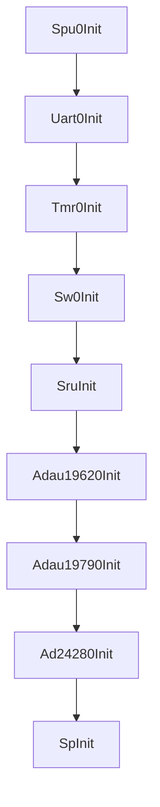
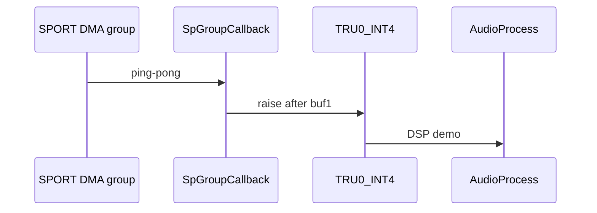
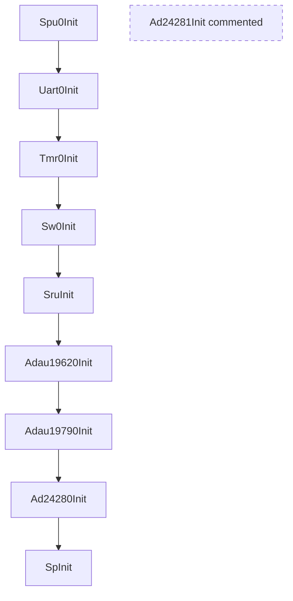
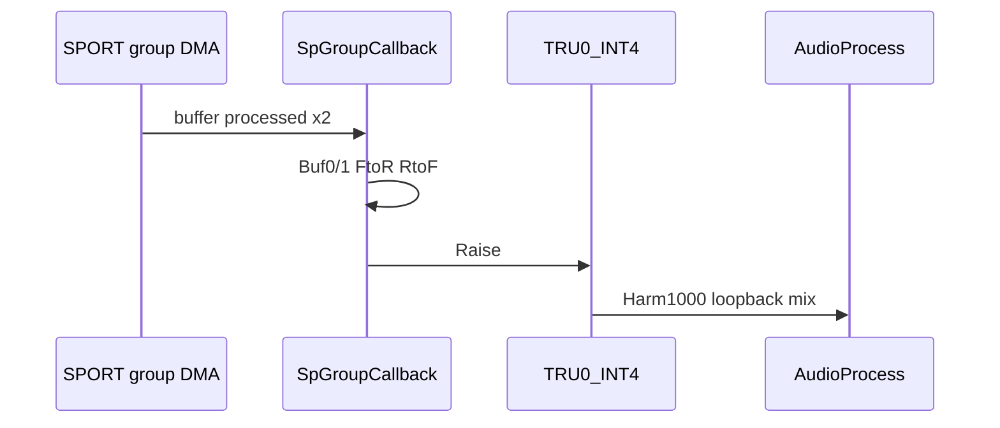

# 音频流：初始化顺序与 AudioProcess / Audio Flow: Init Order and AudioProcess

## English

**Summary:** `AudioFlowInit` brings up SPU, UART, timer, switch, SRU, codecs, AD24280, then SPORT; `AudioProcess` runs on TRU0_INT4 with a demo: **ADC loopback, 1 kHz tone, A2B0 into DAC channels**.

### 1. Code implementation

**Role:** Top-level orchestration in `audio_flow.c`. After `adi_initComponents`, `AudioFlowInit()` runs; real-time DSP is `AudioProcess()` on **TRU0_INT4**, raised from the SPORT global DMA group callback.

**API:** `AudioFlowInit()`, `AudioProcess()`.

**Init chain** (matches code):

- `// Ad24281Init();` — **no second A2B** on official eval board  
- Clock master (1962) before slaves and before `SpInit`

**Runtime:**

**`AudioProcess`:** Uses one base pointer per stream from `dac_out()` / `adc_in()` / `a2b0_in()` and indexes `ch * FRAME_LEN + i` — same pattern as mode **C** in [sport.md](sport.md) 踩坑记录.

Per sample `i`: DAC ch 0–3 ← ADC; 4–7 ← 1 kHz sine; 8–11 ← selected `a2b0_in` slots.

Module notes: other `doc/*.md` files; timing: [tdm_i2s.md](tdm_i2s.md).

### 2. Driver configuration

No register table here — behavior is entirely code-defined:

- `FRAME_LEN = 48` from `sport.h`.  
- AD24281 init commented out.  
- Tone: 1000 Hz phase accumulator at 48 kHz.

### 3. Pitfalls

**Design:** Treat **ADI packaged drivers as the HAL**; this repo is the **impl / application driver** layer. A thinner self-owned HAL is future roadmap work — avoid an extra wrapper unless it serves real app-level adaptation.

**Learning:** Sketch channel indices before changing mix; watch `CpuMsgMon` when adding DSP; keep “clocks before DMA” when editing init.

**Board:** Single **AD24280** path; AD24281 stub — [ad2428.md](ad2428.md).

**Sources:** `audio_flow.c`, `audio_flow.h`

---

## 中文

**摘要：** `AudioFlowInit` 按固定顺序拉起安全、日志、开关、路由、codec、A2B、SPORT；`AudioProcess` 在 SPORT 中断里做 demo：**ADC loopback + 1 kHz tone + A2B0 → DAC**。

### 1. 代码实现

**音频链位置：** 顶层编排位于 `sharc1/src/driver/audio_flow/`；`main` / `adi_initComponents` 之后调用 `AudioFlowInit()`，实时 DSP 在 **TRU0_INT4** 上执行 `AudioProcess()`（由 SPORT 组 DMA 回调经 TRU 触发）。

**公开 API：** `AudioFlowInit()`、`AudioProcess()`（`audio_flow.h`）。

**初始化调用关系：**

| 步骤 | 原因简述 |
|------|----------|
| SPU | DMA 主控权限 |
| UART 然后 TMR | RX DMA 先于 1 ms `Uart0Poll`；`adi_tmr_Config` 后才 Enable |
| Switch | I2C 路径通 |
| SRU | DAI 引脚与时钟扇出 |
| 1962 | **BCLK/FS master** |
| 1979 | ADC slave，依赖时钟 |
| 24280 | A2B 长 init，TWI 占用 |
| Sp | 最后启 DMA，避免无时钟收发包 |
| ~~24281~~ | 官方板无第二 A2B |

**运行时数据流：**

**`AudioProcess` demo（`audio_flow.c`）：** 对 `i = 0 .. FRAME_LEN-1`，`dac_out()` / `adc_in()` / `a2b0_in()` 各返回 **channel-major** 基址，循环内用 `ptr[ch * FRAME_LEN + i]` 下标写入：

| DAC 通道 | 内容 |
|----------|------|
| 0–3 | ADC 同通道 loopback |
| 4–7 | `Harm1000()` 1 kHz 正弦 |
| 8–11 | 选自 `a2b0_in` 的部分 slot |

**控制路径：** 主循环 `MonTmp` 读 UART 命令（含 A2B monitor 等）。

各模块细节见 `doc/*.md`；TDM 见 [tdm_i2s.md](tdm_i2s.md)。

### 2. 驱动配置

无独立寄存器表；顺序与常量由代码固定：

- 块长 `FRAME_LEN = 48`（`sport.h`），与 SPORT DMA 一致。  
- `Ad24281Init()` 注释掉 — 与官方单 A2B 硬件一致。  
- Demo 音：`Harm1000` 相位步进 `1000/48000`，48 kHz 采样。

### 3. 踩坑记录

**架构：** 考虑过再包一层纯应用 HAL，但若不做应用层驱动适配则收益有限。完整自研 HAL 在路线图中；**当前把 ADI 官方库当 HAL**，本仓库只做 **驱动应用 / impl**，保持架构简单。

**扩展建议：** 改 routing 先画 channel-major 下标图（[sport.md](sport.md)）；加算法时看 `CpuMsgMon` emuclk；新 codec 勿破坏「时钟先于 DMA」的 init 链。

**硬件：** 仅 **AD24280** 有效；**SP2** 仍 init 但官方板无 A2B1 — [ad2428.md](ad2428.md)。

**源文件：** `audio_flow.c`, `audio_flow.h`
