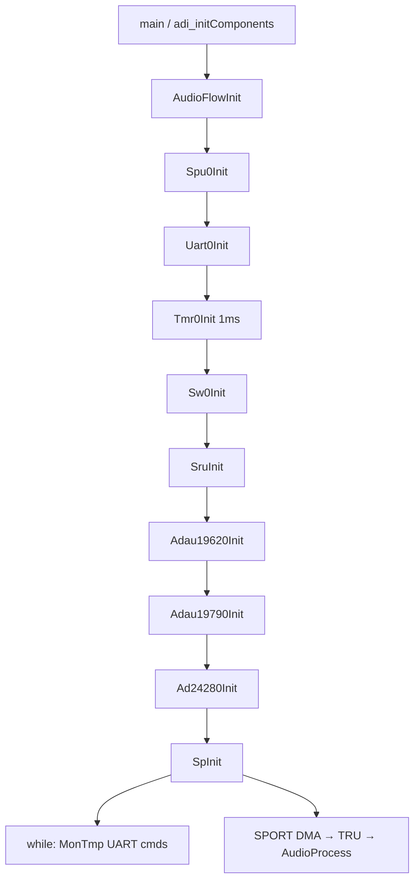
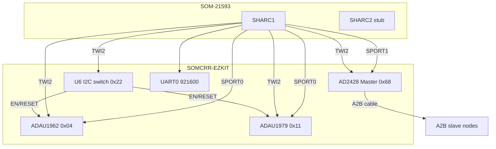

# Hardware Connections & Overall Logic

## English

**Summary:** Official **ADSP-21593** eval (SOM + carrier): SHARC1 runs audio; **ADAU1962** clocks the board; **ADAU1979** ADC; **one AD2428** A2B; TWI2; UART0. **No second A2B.**

### 1. Code implementation

`AudioFlowInit`: SPU → UART → Timer → Switch → SRU → DAC → ADC → A2B0 → SPORT. Real-time: SPORT DMA → `AudioProcess`. Control: UART command loop — [audio_flow.md](audio_flow.md).

Software flowchart in 中文 section.

### 2. Driver configuration

Hardware topology and signal table in 中文 section; SHARC2 stub; single A2B master on carrier.

### 3. Pitfalls

Cross-links to timing, SPORT stagger, A2B/USBi, TWI isolation, UART polling, boards without U6 switch.

**Details:** [sru.md](sru.md), [tdm_i2s.md](tdm_i2s.md), [audio_flow.md](audio_flow.md).

---

## 中文

**摘要：** 基于 **ADI ADZS-21593-EZKIT / SOM-21593 + SOMCRR-EZKIT**。**ADAU1962**、**ADAU1979**、**一路 AD2428**、TWI2、UART0。**无第二路 A2B。**

### 1. 代码实现

**整体软件逻辑：**

- **实时路径：** SPORT DMA → float 转换 → `AudioProcess`（ADC 环回、1 kHz、A2B0→DAC）。  
- **控制路径：** 主循环 UART monitor。

详见 [audio_flow.md](audio_flow.md)。

### 2. 驱动配置

**硬件拓扑：**

| 功能 | 连接要点 |
|------|----------|
| 时钟 | DAC **BCLK/FS master** → DAI1 PB05/PB04 → SRU 扇出 |
| DAC 数据 | SP0A → DAI1 PB01 |
| ADC 数据 | DAI1 PB06 → SP0B |
| A2B0 | SP1A/B ↔ DAI0；回程 PB01/02 → SP1B |
| A2B1 | SRU/SPORT2 遗留，**板上无第二收发器** |
| 控制 | **TWI2**；上电依赖 U6 @ 0x22 |
| 调试 | UART0 `ShtLog` |

引脚表：[sru.md](sru.md)。

### 3. 踩坑记录

| 想了解 | 文档 |
|--------|------|
| TDM/沿/槽 | [tdm_i2s.md](tdm_i2s.md) |
| SP1B 沿错开 | [sport.md](sport.md) |
| SigmaStudio / USBi | [ad2428.md](ad2428.md) |
| TWI 隔离 | [twi.md](twi.md) |
| UART 轮询 | [uart.md](uart.md) |
| 无 U6 国产板 | [switch.md](switch.md) |

官方板仅 **AD24280**；`Ad24281Init` 注释 — [ad2428.md](ad2428.md)。
