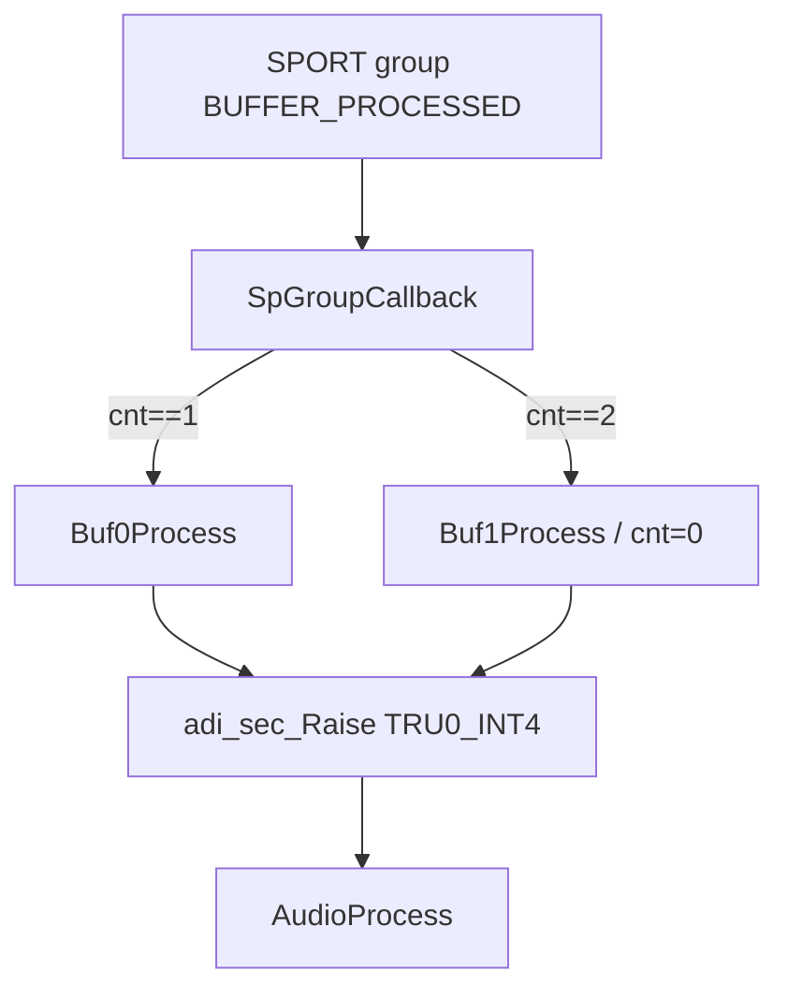
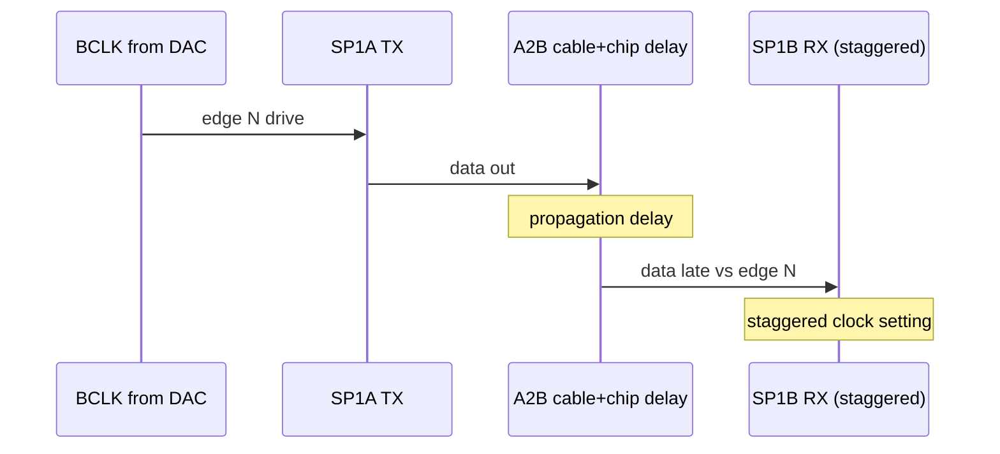

# SPORT — TDM DMA, Group Sync, Clock-Edge Trick

## English

**Summary:** Six half-SPORTs in one global DMA group; float convert in the group callback; `TRU0_INT4` → `AudioProcess`.

### 1. Code implementation

**Chain position:** `SpInit()` last in `AudioFlowInit`. Ping-pong DMA → `SpGroupCallback` → `Buf0/1Process` → TRU → `AudioProcess`.

**API:** `SpInit()`; stream helpers `dac_out()`, `adc_in()`, `a2b0_in()`, … return **channel-major** bases for indexing like `ptr[ch * FRAME_LEN + i]`.

Half-SPORT map: SP0A/0B (16-slot DAC/ADC), SP1A/B (32-slot A2B0), SP2A/B (legacy A2B1, no HW on eval).

`SpGroupCallback`: on each `BUFFER_PROCESSED`, run `Buf0Process` or `Buf1Process` by `cnt`, then **always** `adi_sec_Raise(INTR_TRU0_INT4)` → `AudioProcess` (both halves raise the soft IRQ).

### 2. Driver configuration

`FRAME_LEN=48`, `TDM_NORM=16`, `TDM_A2B=32`; 32-bit slots; early FS; L1 `ADI_CACHE_ALIGN` DMA buffers.

**SP1B vs SP1A:** 4th boolean to `adi_sport_ConfigClock` is **`true` on SP1B**, **`false` on SP1A** — intentional stagger. Full table in the 中文 section below.

Requires prior `Spu0Init()`.

### 3. Pitfalls

**Why A2B is `TDM_A2B = 32`:** It is not one physical 32-slot wire. On the **pins**, A2B uses **two parallel TDM16 data lines** (SPORT primary + secondary): TX `SPT1_AD0` / `SPT1_AD1` → DAI0 PB05/PB06, RX DAI0 PB01/PB02 → `SPT1_BD0` / `SPT1_BD1` (see `signal_route.c`). Software DMA folds both into one **32-slot** buffer (`TDM_A2B = 2 × TDM_NORM`), so the algorithm sees a single TDM32 stream while the board still runs **2×TDM16** on the wire.

**Staggered SP1B clock:** Round-trip A2B + PCB delay vs ~20 ns half-bit at ~24.576 MHz leaves almost no margin if RX uses the same edge relationship as TX. Stagger SP1B’s clock config for phase margin; re-verify after cable/topology changes.

**Buffer access modes:** Per-channel pointer helpers (~30 MIPS) vs one base + index (~7 MIPS) — use **mode C** like `AudioProcess`. Data in **L1**; compiler CSE is the issue, not L2 cache.

**DMA buffers:** Keep audio DMA regions **L1-aligned / uncached** so CPU and DMA see the same memory ([uart.md](uart.md)).

**Other:** Ping-pong phase; SP2 DMA without second A2B.

**Sources:** `sport.c`, `sport.h`

---

## 中文

**摘要：** 6 个半 SPORT 全局组 DMA；组回调里 float↔int32，再 **TRU0_INT4** → `AudioProcess`。TDM 常量见 [tdm_i2s.md](tdm_i2s.md)，布线见 [sru.md](sru.md) / [hardware.md](hardware.md)。

### 1. 代码实现

**音频链位置：** `SpInit()` 在 `AudioFlowInit` **最后**（codec/A2B 时钟已就绪）；DMA 满半缓冲 → `SpGroupCallback` → `Buf0Process` / `Buf1Process` → TRU → `AudioProcess()`。

**公开 API / 缓冲访问（`sport.h` / `sport.c`）：** `SpInit()`；`dac_out()`、`adc_in()`、`a2b0_in()`、`a2b0_out()` 等返回 **channel-major** float 基址（与 `AudioProcess` 下标方式一致）。

| 半 SPORT | 方向 | 对端 | TDM |
|----------|------|------|-----|
| SP0A | TX | ADAU1962 DAC | 16 |
| SP0B | RX | ADAU1979 ADC | 16 |
| SP1A | TX | AD24280 | 32 |
| SP1B | RX | AD24280 | 32 |
| SP2A/B | TX/RX | A2B1（官方板无硬件） | 32 |

**双缓冲与回调：**

`SpGroupCallback` 在每次 `BUFFER_PROCESSED` 里：`cnt++` → `cnt==1` 走 `Buf0Process`，`cnt==2` 走 `Buf1Process` 并清零；**无论走哪一路，随后都会** `adi_sec_Raise(INTR_TRU0_INT4)` 触发软中断 → `AudioProcess`。

DMA 缓冲：**time-major** int32；`SpMsg` float：**channel-major**；`__builtin_conv_FtoR` / `RtoF` 在 `Buf0/1Process` 中转换。

**CPU 负载：** `emuclk` 差值 `/ 1000.f` → 相对负载；`CpuMsgMon()` 打印。

### 2. 驱动配置

| 项 | 值 / 说明 |
|----|-----------|
| `FRAME_LEN` | 48 |
| `TDM_NORM` / `TDM_A2B` | 16 / 32 |
| DMA | `XModify = 4`，长度 `FRAME_LEN × TDM_*` |
| 缓冲段 | L1 `ADI_CACHE_ALIGN`（`#pragma default_section`） |
| 字长 | `ConfigClock(..., 32, ...)`，sign-fill 31+1 |
| FS | `ConfigFrameSync(..., 31, ...)`，early FS `true` |
| 全局组 | 六路半 SPORT 同步启停 |

**`adi_sport_ConfigClock(h, 32, rising?, internal?, gated?)` 第 4 参（InternalClock / 相位相关）：**

| 半 SPORT | 第 4 参 |
|----------|---------|
| SP0A → DAC | `true` |
| SP0B ← ADC | `false` |
| SP1A → A2B0 | `false` |
| **SP1B ← A2B0** | **`true`**（与 SP1A 错开） |
| SP2A/B | `true`（遗留第二路） |

必须先 `Spu0Init()` — [spu.md](spu.md)。

### 3. 踩坑记录

**为什么 A2B 可以是 TDM32：** 并不是一根线上跑 32 slot。在**引脚**上，A2B 实际是 **两路并行的 TDM16 数据线**（SPORT 主/副数据口）：发送 `SPT1_AD0` / `SPT1_AD1` → DAI0 PB05/PB06，接收 DAI0 PB01/PB02 → `SPT1_BD0` / `SPT1_BD1`（见 `signal_route.c`）。软件 DMA 把两路合成一块 **32 slot** 缓冲（`TDM_A2B = 2 × TDM_NORM`），算法侧看成一条 TDM32，板级/管脚仍是 **2×TDM16**。

**SP1B 时钟沿错开（A2B0 RX）：** 板级 BCLK/FS 由 ADAU1962 经 SRU 扇出。A2B 往返 + 走线 **传播时延** 在 ~24.576 MHz 下半个 bit 仅 ~20 ns；若 SP1B 与 SP1A 用完全相同的沿关系，setup/hold 易被吃掉 → 偶发错字/静音。**SP1B 故意错开一档 InternalClock 配置换相位裕量。** 改沿前用示波器看 SP1B 数据相对 BCLK；换线长或拓扑后可能要重标定。

**SPORT float 访问模式（L1 数据，无多级 cache 惩罚）：**

| 模式 | 做法 | 约略算力 |
|------|------|----------|
| A | 直接暴露 `SpMsg*` | ~6.7 MIPS |
| B | 每通道函数返回 `float*` | ~30 MIPS |
| C | 每总线一次 `adc_in()` 等返回基址，循环内下标 | ~7 MIPS |

B 慢在编译器 **不敢做寄存器缓存** — 每次重算指针。工程采用 **C**（见 `audio_flow.c`）。

**DMA 缓冲：** 须 **L1 对齐 / uncached 策略**（与核并行访问一致），避免 DMA 与 cache 不一致；详见 [uart.md](uart.md) 踩坑记录。

**其它坑：** 双缓冲相位 — `AudioProcess` 写的是**下一块**要用的 float；官方板无 A2B1 但 SP2 仍跑 DMA。

**源文件：** `sport.c`, `sport.h`
