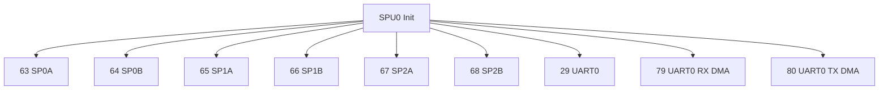
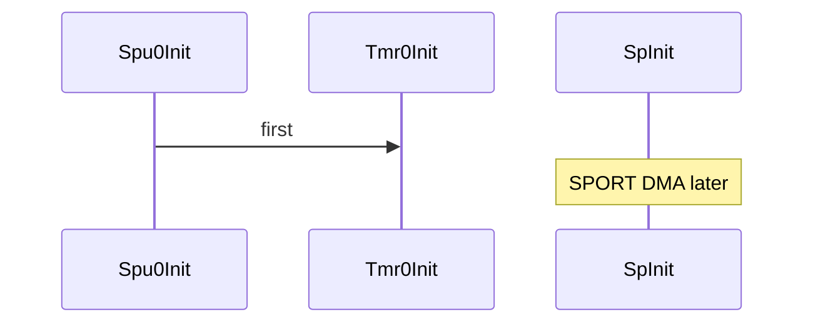

# SPU：安全主控使能 / SPU: Secure Master Enable

## English

**Summary:** `Spu0Init` enables **secure master** for SPORT 63–68, UART0 29, DMA 79–80. **First** in audio bring-up.

### 1. Code implementation

**Role:** Before timer, UART, and long before `SpInit`.

**API:** `Spu0Init()`.

Nine targets in `spu0_target[]` — diagram in 中文 section.

### 2. Driver configuration

Loop `adi_spu_EnableMasterSecure(..., true)` after `adi_spu_Init`.

### 3. Pitfalls

Missing one half-SPORT ID; wrong ID if peripheral instance changes; easy to overlook in bare-metal bring-up.

**Sources:** `spu.c`


---

## 中文

**摘要：** `Spu0Init` 对六路半 SPORT 与 UART0+RX/TX DMA 调用 `adi_spu_EnableMasterSecure`。**必须最先**（`AudioFlowInit` 第一步）。

### 1. 代码实现

**音频链位置：** 任何 SPORT/UART DMA 之前。

**公开 API：** `Spu0Init()`（`spu.h`）。



共 **9** 项（`SPU0_SVC_NUM`）。



### 2. 驱动配置

**模式：**

```text
adi_spu_Init(SPU0_DEV, ...);
for each id in spu0_target[]:
  adi_spu_EnableMasterSecure(spu0_dev, id, true);
```

| ID | 对象 |
|----|------|
| 63–68 | SP0A–SP2B |
| 29 | UART0 |
| 79–80 | UART0 RX/TX DMA |

无运行时关闭 — 一次 init 贯穿开机。

### 3. 踩坑记录

1. **漏 Enable 某半 SPORT** → 对应 DMA 异常。  
2. **改 UART/SPORT 实例** → 同步改 `spu0_target[]`。  
3. CCES 工程里 SPU 易忽略 — 对照 ADI SPU 文档。

**源文件：** `spu.c`, `spu.h`
