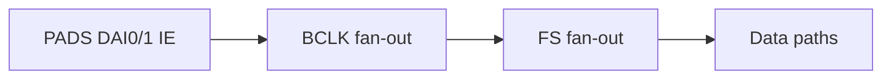
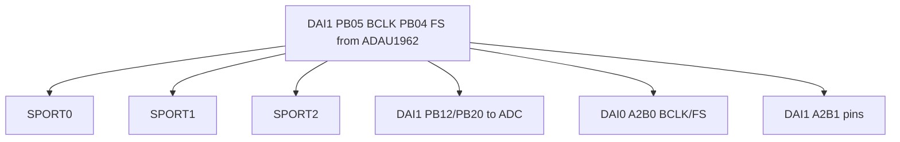

# SRU / DAI 信号路由 / SRU / DAI Signal Routing

## English

**Summary:** `SruInit` fans **DAC BCLK/FS** to all SPORT halves and codec/A2B pins; connects data paths per `signal_route.c`.

### 1. Code implementation

**Role:** After switch, before codecs in `AudioFlowInit`.

**API:** `SruInit()`.

Data route table in 中文 section; init: enable DAI IE → BCLK → FS → data.

### 2. Driver configuration

Clock source DAI1 PB05/PB04 from ADAU1962; fan-out to SPORT0/1/2, ADC, A2B0/1 DAI pins — mermaid in 中文 section.

### 3. Pitfalls

Custom boards need full SRU rework; A2B1 pins wired without second transceiver; dual data lines for A2B.

**Sources:** `signal_route.c`

---

## 中文

**摘要：** `SruInit` 使能 DAI pad，将 **ADAU1962 的 BCLK/FS** 扇出到 SPORT/ADC/A2B，并连接数据线。以 `signal_route.c` 为准。

### 1. 代码实现

**音频链位置：** `AudioFlowInit` 中 Switch 之后、**Adau19620Init 之前** — 引脚路由就绪，codec 上电后 BCLK/FS 才有效。

**公开 API：** `SruInit()`（`signal_route.h`）。

**数据线：**

| SPORT | 方向 | DAI 引脚 |
|-------|------|----------|
| SP0A TX | → DAC | DAI1 PB01 ← SPT0_AD0 |
| SP0B RX | ← ADC | DAI1 PB06 → SPT0_BD0 |
| SP1A TX | → A2B0 | DAI0 PB05/PB06 |
| SP1B RX | ← A2B0 | DAI0 PB01/PB02 |
| SP2A/B | A2B1 | DAI1 PB19/10, PB11/07 |

`PBEN` HIGH = 驱动输出；LOW = 输入至 SPORT。

### 2. 驱动配置

**时钟树：**

- BCLK 源：**DAI1_PB05**（`DAI1_PBEN05` LOW = pin 输入）  
- FS 源：**DAI1_PB04**

主从角色见 [tdm_i2s.md](tdm_i2s.md)。

### 3. 踩坑记录

1. **改 pin 必改 SRU 与 PCB** — 自定义板需整张表重审。  
2. **A2B1 引脚仍路由** — 无 AD24281 时 SP2 仍接 DAI1。  
3. **A2B 双数据线** 对应 SP1 AD0/AD1、BD0/BD1。

**源文件：** `signal_route.c`, `signal_route.h`
