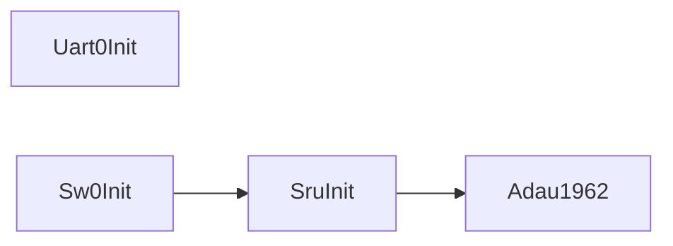
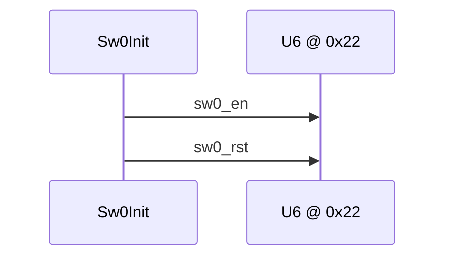

# 板级 I2C Switch / Mux / Board I2C Switch / Mux (U6)

## English

**Summary:** `Sw0Init` programs **U6 @ 0x22** with enable then reset-release before codecs/A2B.

### 1. Code implementation

**Role:** After UART, before SRU/codecs in `AudioFlowInit`.

**API:** `Sw0Init()` → `SwCfg` twice with own `Twi2Open`/`Twi2Stop`.

### 2. Driver configuration

I2C **0x22**; tables `sw0_en` (`0x12=0x05`) then `sw0_rst` (`0x12=**0x25**` releases ~ADAU_RESET). Active-low enables on port A bits 6–7.

### 3. Pitfalls

Skip switch → codec NAK; enable without reset release → stuck reset; do not reorder en/rst.

**Domestic boards without soft switch:** TWI to `0x22` always fails — no codec bring-up until hardware matches ([ad2428.md](ad2428.md) cross-ref).

**Sources:** `switch.c`, `switch0_reg.c`


---

## 中文

**摘要：** `Sw0Init` 向 **U6**（**`0x22`**）写 enable / reset 表，给 ADAU1962 / ADAU1979 上电并释放复位。必须在 codec/A2B **之前**。

### 1. 代码实现

**音频链位置：** `AudioFlowInit` 中 `Uart0Init` 之后、`SruInit` 之前 — **codec 能响应 TWI 的前置条件**。



**公开 API：** `Sw0Init()`；内部 `SwCfg()` 逐条写表。

**流程：**

```text
Twi2Open();
SwCfg(SW0_DEV, sw0_en, SW0_EN_LEN);
SwCfg(SW0_DEV, sw0_rst, SW0_RST_LEN);
Twi2Stop();
```

`SwCfg`：`Twi2DevAddrSet` → 逐条 `Twi2RegShtWr` → `TIME_BND` nop。

### 2. 驱动配置

**I2C 地址：** **0x22**（MCP23017 风格扩展）。

**寄存器（`switch0_reg.c`）：**

| 地址 | 含义 |
|------|------|
| `0x12` | GPIOA OLATA |
| `0x13` | GPIOB OLATB |
| `0x00` / `0x01` | IODIRA / IODIRB |

**Port A 低有效：** bit7 `~ADAU1979_EN`，bit6 `~ADAU1962_EN`，bit5 `~ADAU_RESET`。

| 阶段 | `0x12` | `0x13` | `IODIRA` | `IODIRB` |
|------|--------|--------|----------|----------|
| `sw0_en` | **0x05** | **0xFD** | 0x18 | 0x00 |
| `sw0_rst` | **0x25** | **0xFD** | 0x18 | 0x00 |

`sw0_en`：使能两颗 codec，**仍保持 reset**；`sw0_rst`：bit5=1 → **释放 ~ADAU_RESET**。



### 3. 踩坑记录

1. **跳过 Sw0Init** → codec PLL 超时或 TWI NAK。  
2. **只写 en 不写 rst** → 器件卡在复位。  
3. **`Sw0Init` 自带 Open/Stop** — 勿与其它 init 嵌套未 Stop 的 TWI。  
4. **勿调换 en/rst 顺序**。

**国产板：** 部分评估/国产载板 **没有 U6 soft switch** → TWI 写 `0x22` 一直 NAK，后续 codec/A2B init 全部失败 — 需对照实际硬件是否有等价上电逻辑。

**源文件：** `switch.c`, `switch0_reg.c`, `switch_reg.h`
