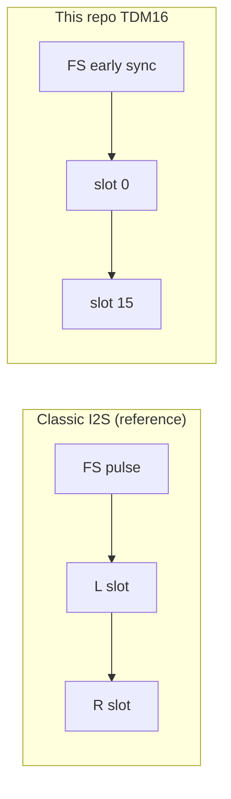
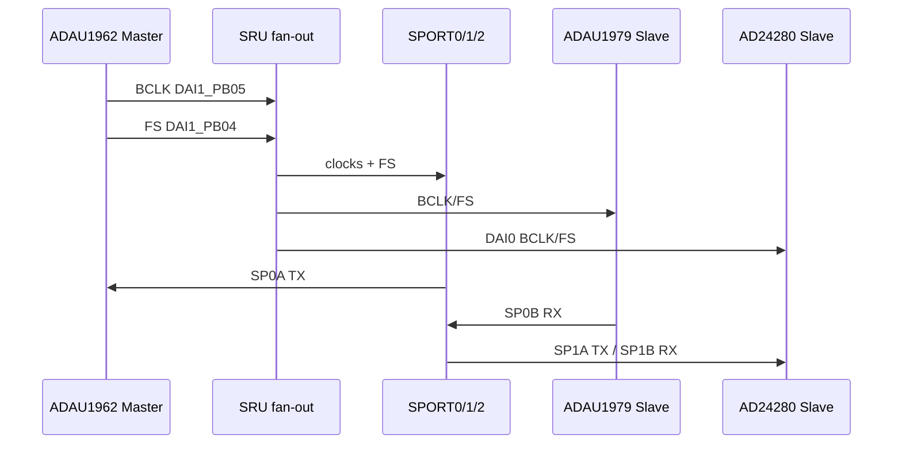
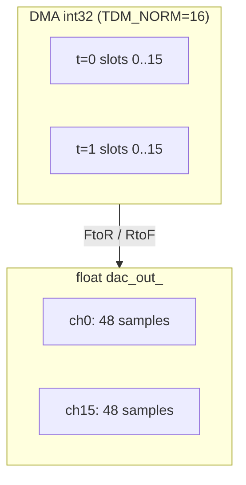
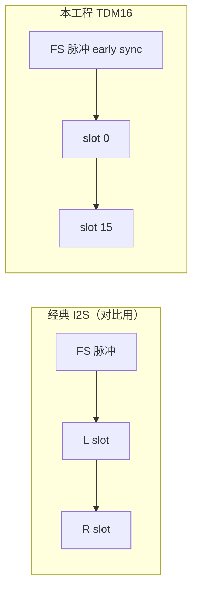
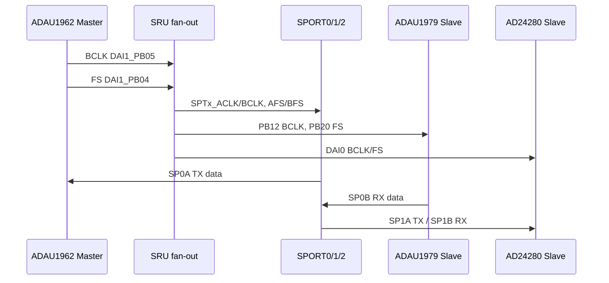
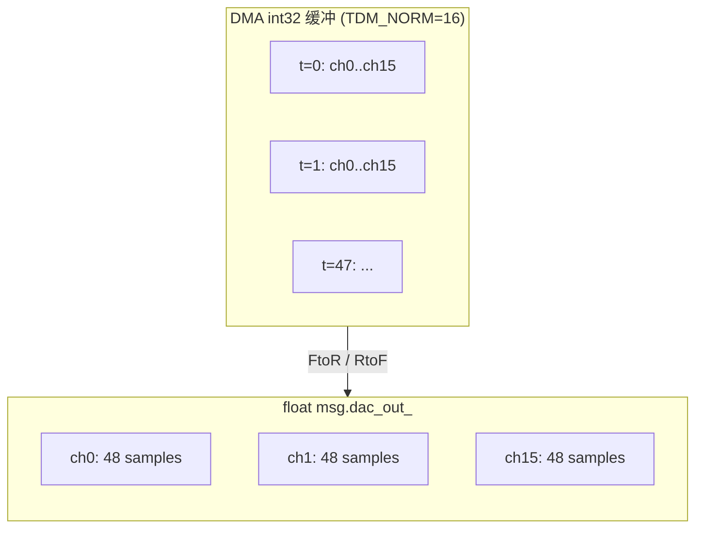

# TDM / I2S / SPORT 时序 / TDM / I2S / SPORT Timing

## English

**Summary:** **Single detailed** serial-audio timing note in this repo. Other drivers **link here**. Settings: 48 kHz, TDM16/32, 32-bit slots, early FS, falling-edge sampling.

### 1. Code implementation

**Constants:** `FRAME_LEN=48`, `TDM_NORM=16`, `TDM_A2B=32`; SPORT **MC mode** — see `sport.h`, `sport.c`.

**I2S vs TDM16:**

**Clock/data sequence:**

**Buffer layout:** Hardware `buf[i * TDM + j]`; software `channel[j * FRAME_LEN + i]`; convert in `Buf0/1Process`.

**Master/slave:** DAC master; ADC, A2B, SPORT slaves on SRU fan-out — pin list [sru.md](sru.md).

**A2B export mismatch** → wrong channel map; check slot count, early FS, edges.

### 2. Driver configuration

BCLK/frame ≈ 512 cycles @ 16×32; ~24.576 MHz BCLK order of magnitude.

SPORT: 32-bit slots, FS length 31, early FS; half-SPORT table in 中文 section.

Codec register intent: [adau1962.md](adau1962.md), [adau1979.md](adau1979.md), [ad2428.md](ad2428.md).

### 3. Pitfalls

1. **Tuning only SPORT** — DAC master registers still define wire format.  
2. **Index order** — DMA time-major vs `AudioProcess` channel-major.  
3. **Clock source** — BCLK from DAI1 PB05, not SP0A.  
4. **SP2 / AD24281** — one A2B on official eval only.

Cross-links: [sru.md](sru.md), [sport.md](sport.md), [audio_flow.md](audio_flow.md).

---

## 中文

**摘要：** 仓库里音频串行接口的**唯一深度说明**。ADAU1962、ADAU1979、AD2428、SPORT 只做交叉引用。对齐 48 kHz、TDM16/32 slot、32-bit 字长、early FS、下降沿采样。

### 1. 代码实现

**本工程名字与代码位置：**

| 概念 | 代码常量 | 含义 |
|------|----------|------|
| 每通道每块采样数 | `FRAME_LEN = 48` | ~1 ms @ 48 kHz |
| DAC/ADC 时隙 | `TDM_NORM = 16` | 16-slot TDM |
| A2B 时隙 | `TDM_A2B = 32` | 2×16 |
| SHARC 接口 | SPORT **MC 模式** | 多通道 TDM |

相关：`sport.h`；`adi_sport_Config*` in `sport.c`；转换在 `Buf0Process`/`Buf1Process`。

**I2S vs TDM16（用法对比）：**

**BCLK / FS / DATA 数据流：**

**32-bit slot 与缓冲索引（算法必读）：**

DMA 一次 `FRAME_LEN × slots` 个 **int32**（`XModify = 4`）。

- **硬件（SPORT）time-major：** `buf[i * TDM + j]`  
- **软件 float（`SpMsg`）channel-major：** `channel[j * FRAME_LEN + i]`  
- `AudioProcess` 须用 `dac_out()` / `adc_in()` 的 **channel-major** 布局。

A2B 路径 `TDM_A2B = 32`，规则相同。

**主从角色（评估板）：**

| 设备 | I2C | 串行时钟 |
|------|-----|----------|
| ADAU1962 | 0x04 | **Master** BCLK/FS |
| ADAU1979 | 0x11 | **Slave** |
| AD24280 | 0x68/0x69 | **Slave** 朝向 SHARC |
| SHARC SPORT | — | **Slave**（共享 BCLK/FS） |

时钟**源**在 DAC；SRU 扇出 — [sru.md](sru.md)。

**与 A2B 导出一致性：** 若 SigmaStudio/SPORT slot 不一致 → **slot 错位**；排查：① `TDM_NORM` vs `TDM_A2B` ② early FS/边沿 ③ SRU 同一 BCLK/FS。

### 2. 驱动配置

@ 48 kHz、16 slot、32 bit/slot：

- 每帧 BCLK ≈ `16 × 32 = 512`  
- BCLK 频率 ≈ `48000 × 512 ≈ 24.576 MHz`（以 DAC PLL 为准）

**SPORT TDM 参数摘要（`sport.c`）：**

| 半 SPORT | 方向 | MC channels | 用途 |
|----------|------|-------------|------|
| SP0A | TX | 0–15 | → DAC |
| SP0B | RX | 0–15 | ← ADC |
| SP1A/B | TX/RX | 0–31 | ↔ A2B0 |
| SP2A/B | TX/RX | 0–31 | A2B1（无硬件） |

- 字长：`ConfigClock(..., **32**, ...)`，sign-fill `ADI_SPORT_DTYPE_SIGN_FILL, **31**`  
- FS：`ConfigFrameSync(..., **31**, ...)`，**early FS** `true`  
- SP0A `ConfigClock(..., false, **true**, false)` — TX 但时钟来自外部 pin  
- **Global group** 六路同步 — [sport.md](sport.md)（含 **SP1B 沿错开**）

**Codec/A2B 寄存器意图（交叉引用）：** ADAU1962 master TDM16 early sync MSBF falling edge — [adau1962.md](adau1962.md)；ADAU1979 slave — [adau1979.md](adau1979.md)；`ad2428_reg.h` 注释与上同 — [ad2428.md](ad2428.md)。

### 3. 踩坑记录

1. **只改 SPORT 不改 codec/A2B 表** — DAC master 仍定帧格式。  
2. **混淆 DMA vs float 索引** — 写 DSP 前画 channel-major 图。  
3. **误以为 SP0A 产生 BCLK** — 来自 DAI1 PB05（DAC）。  
4. **A2B1 / SP2** — 官方板无 AD24281，勿强测第二路。

**交叉链接：** [sru.md](sru.md)、[sport.md](sport.md)、[audio_flow.md](audio_flow.md)。
