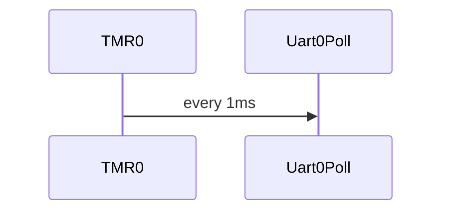
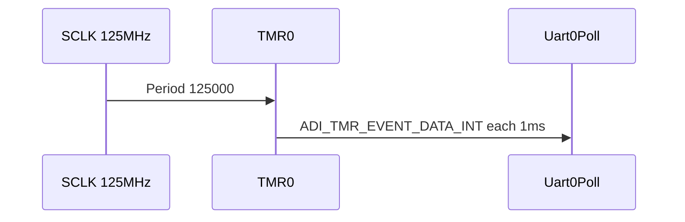

# TMR0：1 ms 系统节拍 / TMR0: 1 ms Tick

## English

**Summary:** **TMR0** at **125000** counts @ **125 MHz** SCLK → **1 ms** IRQ calling **`Uart0Poll`**.

### 1. Code implementation

**Role:** 1 ms tick for UART RX ring producer; after SPU in `AudioFlowInit`.

**API:** `Tmr0Init`, optional `Tmr0En`/`Tmr0Close`.

### 2. Driver configuration

`TMR0_1MS = 125000`, sysclk, continuous mode, period interrupt. `Tmr0Init` calls `adi_tmr_Config` before `adi_tmr_Enable`.

### 3. Pitfalls

Wrong SCLK → wrong period; disabling timer stalls UART RX; keep ISR lightweight.

**Sources:** `timer.c`

---

## 中文

**摘要：** **TMR0** 连续模式，**Period = 125000**（SCLK **125 MHz** / 1000 ≈ **1 ms**）；中断里 **`Uart0Poll`**。

### 1. 代码实现

**音频链位置：** `Tmr0Init()` 在 `Uart0Init()` 之后（`AudioFlowInit`：Spu → Uart → Tmr）。RX DMA 先启动，1 ms 节拍再调用 `Uart0Poll`。`adi_tmr_Config()` 把 `tmr0_cfg` 写入定时器后才 `Enable`。

**公开 API：** `Tmr0Init()`, `Tmr0En()`, `Tmr0Close()`（`timer.h`）。

**数据流：** TMR ISR → `Uart0Poll` → 更新 `rx_wr_idx` — [uart.md](uart.md)。

### 2. 驱动配置

| 项 | 值 |
|----|-----|
| `TMR0_DEV` | 0 |
| `TMR0_1MS` | **125000** |
| Clock | `ADI_TMR_CLKIN_SYSCLK` |
| Mode | Continuous PWM out + period IRQ |
| `Width` | `Period >> 2` |

Init 顺序见 [audio_flow.md](audio_flow.md)。

### 3. 踩坑记录

1. **SCLK 非 125 MHz** — Period 需重算。  
2. **关闭 TMR** — UART RX 写指针不更新。  
3. **回调仅 Poll** — 勿在 TMR ISR 做重活。

**源文件：** `timer.c`, `timer.h`
