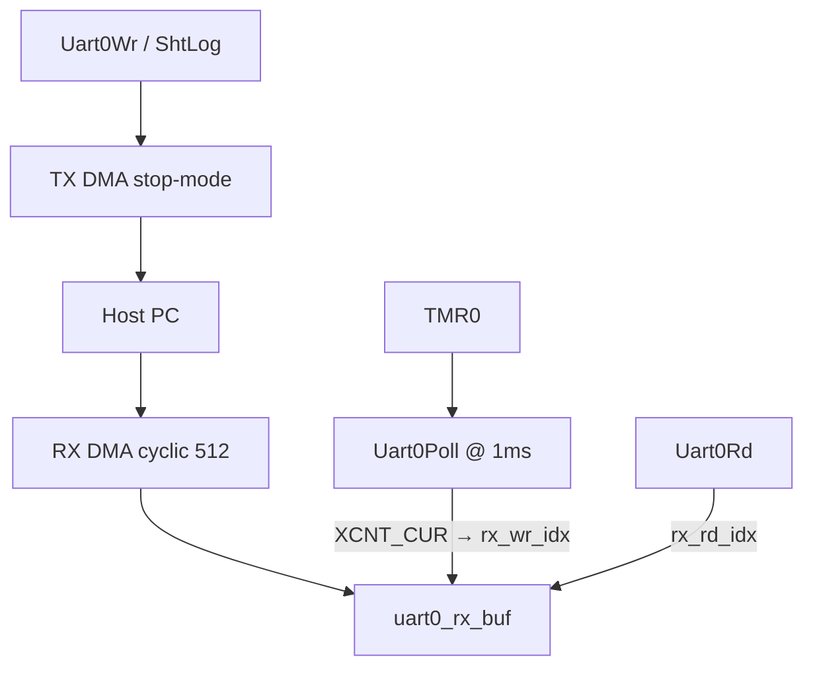
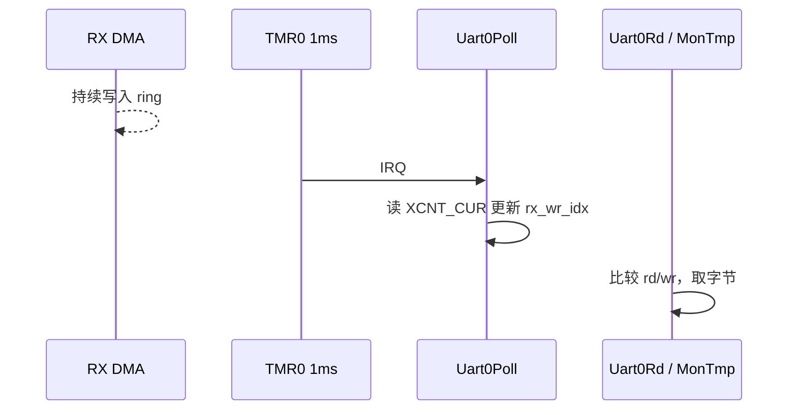

# UART0 — DMA Ring & Polling R/W

## English

**Summary:** UART0 @ **921600**, **512-byte** cyclic RX DMA; **1 ms** `Uart0Poll` advances the write index; `Uart0Rd` consumes; `Uart0Wr` waits for TX-done. `ShtLog` in `algo/log/log.c`.

### 1. Code implementation

**Role:** Debug/monitor path after SPU and timer init in `AudioFlowInit`.

**API:** `Uart0Init`, `Uart0Poll`, `Uart0Rd`, `Uart0Wr`.

**RX:** Cyclic DMA fills the ring continuously. Production index from **`pREG_DMA21_XCNT_CUR`** (UART0 RX DMA channel 21): `wr_idx = DMA_LEN - XCNT`, with `XCNT == 0` mapped back to index 0. `Uart0Poll` runs every 1 ms. `Uart0Rd` pops one byte or returns underrun if `rd == wr`.

**TX:** Stop-mode DMA; wait on `is_tx_over` (volatile) with timeout; chunk if `len > 512`.

See mermaid diagrams in 中文 section.

### 2. Driver configuration

921600 (`DIV=136`), 512-byte ring, 1 ms poll from TMR0 @ 125 MHz SCLK, L1 `ADI_CACHE_ALIGN` buffers.

### 3. Pitfalls

**Races / cache:** DMA buffers uncached/L1-aligned; shared ISR/main fields `volatile`; snapshot indices into locals at entry. Lock-free ring because UART has no byte clock — 1 ms producer poll.

**stdio:** Use `#include <stdio.h>` for `snprintf` in log paths.

**Pitfalls:** Timer off → RX stuck; heavy logging from audio ISR blocks on TX wait.

**Sources:** `uart.c`, `timer.c`, `algo/log/log.c`


---

## 中文

**摘要：** UART0 @ **921600**（`DIV=136`），RX **512** 字节 DMA 自环；**TMR0 1 ms** 调 `Uart0Poll` 更新写指针；主循环/`MonTmp` 调 `Uart0Rd`；发送用 `Uart0Wr` 等 TX 完成。格式化日志 `ShtLog` 在 `algo/log/log.c`，内部调 `Uart0Wr`。

### 1. 代码实现

**音频链位置：** `Uart0Init` 在 `AudioFlowInit` 中 SPU/TMR 之后、Switch 之前；**非实时音频路径**，供调试与 monitor 命令。

**公开 API：** `Uart0Init`, `Uart0Poll`, `Uart0Rd`, `Uart0Wr`（`uart.h`）。

**整体数据流：**



**RX（生产者 = 硬件 + 1 ms Poll）：**

- `Uart0Init` 启动自环 descriptor 的 `DMARead`，硬件持续写 `uart0_rx_buf[512]`。
- UART **无字节时钟线**标定帧长，不能单靠「RX 完成」当生产者。
- `Tmr0Callback` → **`Uart0Poll`** 每 1 ms：

```text
xcnt = *pREG_DMA21_XCNT_CUR;          // UART0 RX = DMA21，剩余传输数
若 xcnt==0，写指针记为 0（而不是 DMA_LEN）
检测 overrun：写指针跨越读指针，或落到读指针上
rx_wr_idx = cur_wr_idx;
```

- **`Uart0Rd`：** 若 `rx_rd_idx == rx_wr_idx` → underrun，返回 1；否则取一字节，`rx_rd_idx` 回绕。



**TX（消费者 = 回调置位）：**

- `is_tx_over` 初值 1；`Uart0Wr` 清 0 → `memcpy` → `adi_uart_DMAWrite(..., STOP_MODE)` → 回调 `TX_PROCESSED` 置 1。
- `len > 512` 分块；每块前 **忙等** `is_tx_over`（超时 `TIME_BND`）。

### 2. 驱动配置

| 项 | 值 |
|----|-----|
| `UART0_DIV` | 136 → **921600** baud |
| `UART0_PRESCALE` | 1 |
| `DMA_LEN` | 512 |
| Poll 周期 | TMR0 **Period = 125000** @ **125 MHz** SCLK → 1 ms |
| 缓冲 | L1 `ADI_CACHE_ALIGN`：`uart0_rx_buf`, `uart0_tx_buf`, descriptors |
| `uart0_msg` | `volatile` + cache-aligned |

**过载估算：** 921600 ≈ 92 byte/ms；ring=512，主循环及时 `Uart0Rd` 不易 overrun。

### 3. 踩坑记录

**竞态与优化：** 多级 cache、寄存器缓存、指令重排、SIMD 都可能引入跨上下文问题。本工程要点：

- DMA 缓冲：**L1 / uncached 对齐**，禁止核 cache 与 DMA 不一致（SPORT 音频缓冲同理 — [sport.md](sport.md)）。
- 跨 ISR 共享：`rx_wr_idx`、`rx_rd_idx`、`is_tx_over` 等 **`volatile`**；读路径开头 **快照到局部变量**（`Uart0Poll` / `Uart0Rd`）。
- UART 无帧同步 → **无锁环形队列** + 1 ms 生产者 Poll（非 per-byte IRQ）。

**`snprintf`：** 格式化日志需 `#include <stdio.h>`（`log.c` / `uart.c` 路径）。

**坑：** 忘记开 Timer → `rx_wr_idx` 不更新；在 Audio ISR 里大量 `ShtLog` → TX 忙等拖死实时路径。

**源文件：** `uart.c`, `uart.h`, `timer.c`, `algo/log/log.c`
